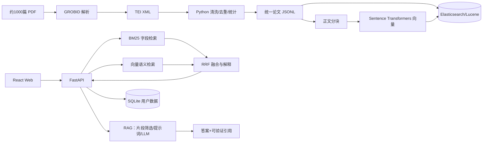
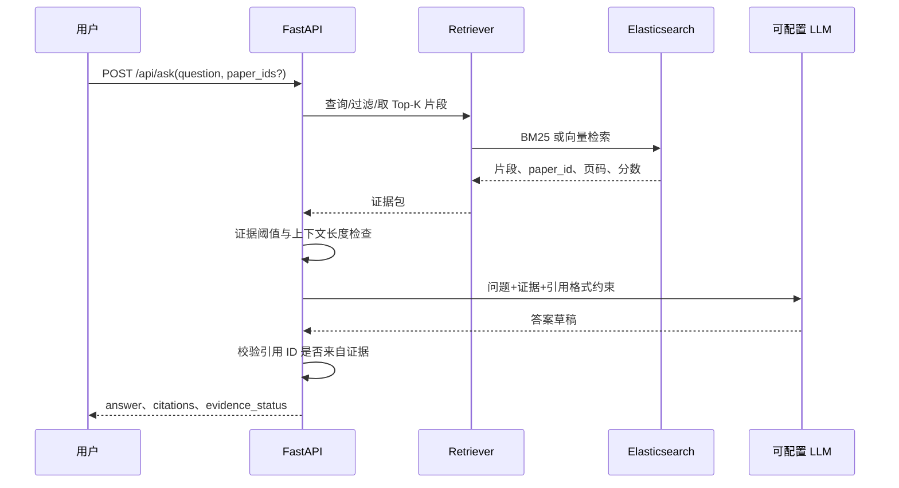

# 02 技术架构与数据流程

> 2026-10-26：后端 P0 已放行，使用 Elasticsearch 8.19.23 Windows ZIP（自带 JDK）+ Python 3.11 + FastAPI + Elasticsearch Python 8.19 客户端；本机无 Docker，使用本地进程、loopback 和 512 MB JVM 堆。实际验证见 backend/archive/20261026-27/VERIFICATION.md。历史P0时这些事项待确认；V2已选择MiniLM CPU向量模型，大模型供应商、Java Lucene直接调用与Docker编排仍待会议确认。

## 1. 分层设计

2026-10-27后端V2：组长根据本次Goal附件放行语义/RRF/RAG及SQLite/上传后端。BM25别名保留859篇；MiniLM ONNX CPU2线程生成384维向量到独立scholarlens-vectors-*，按paper_id折叠最佳片段，精确cosine扫描后RRF(k=60)。900字符/重叠100的片段ID和字符locator可追溯。SQLite保存哈希会话、用户隔离收藏历史、上传审核和任务租约；上传审核后发布独立scholarlens-uploads-*，不覆写基础索引。AI服务配置留空，兼容适配器进行引用校验，真实PDF与GROBID缺失独立报告。资源、运行证据和前端接口见backend/archive/20261026-27/BACKEND_V2_GOAL.md与FRONTEND_API_GUIDE.md。

2026-10-27：实际链路已推进至正式JSONL→独立index-ready文件（原件保留）→样本20篇→859篇real别名→8001验收→8000默认real。复用已有Mapping和导入器，Mock、样本及前代generation保留，未启动GROBID或新增模型。质量与回退详见backend/archive/20261026-27/REAL_DATA_VERIFICATION.md。

| 层 | 组件 | 输入 | 输出 | 负责人 | 运行条件与风险 |
|---|---|---|---|---|---|
| 数据源 | 本地 PDF 集 | PDF 文件 | 文件清单 | 组员 A | 版权、命名、损坏文件 |
| 解析 | GROBID + Python | PDF/XML | 结构化 XML | 组员 A | GROBID 服务、Java/内存、版式差异 |
| 规范化 | Python 清洗脚本 | XML | 论文 JSONL、质量统计 | 组员 A | schema 版本、缺失值、重复 ID |
| 索引 | Elasticsearch/Lucene | JSONL | 倒排索引、向量字段 | 组长 | ES 内存、映射和版本 |
| 检索 | FastAPI service | 查询参数 | BM25/语义/混合候选 | 组长 | 查询超时、分数可比性 |
| RAG | Retriever + 可配置 LLM | 问题、片段 | 答案和引用 | 组长 | API Key、幻觉、证据不足 |
| 表现层 | React/Vite | API JSON | 搜索/详情/问答界面 | 组员 B | CORS、响应式和错误状态 |
| 用户数据 | SQLite | 登录/收藏/历史 | 记录 | 组长 | 并发、迁移、权限 |

## 2. 总体 Mermaid 图

## 3. 数据处理流程

1. **清单化**：扫描输入目录，生成 `source_file`、大小、哈希和处理状态；不改变原始 PDF。
2. **解析**：调用 GROBID 得到 TEI XML；失败重试有限次数，记录错误类型和时间。
3. **映射**：从 XML 映射标题、作者、日期、机构、地址、页数、摘要、正文和 PDF 路径，按 [03_DATA_SCHEMA](03_DATA_SCHEMA.md) 输出。
4. **清洗**：规范空白、日期和作者数组；用来源文件哈希或稳定规则生成 `paper_id`；检查重复标题/哈希。
5. **统计**：输出总数、成功率、每字段完整率、重复数、失败清单和处理耗时。
6. **分块与向量**：仅在 P1 放行后按段落/页码分块，保留 `paper_id`、`chunk_id`、页码/定位和文本；向量模型与维度记入运行报告。

## 4. 索引与检索

- 六个课程要求字段：`title`、`authors`、`date`、`affiliation`、`address`、`fulltext`；可增加 `abstract`、`year`、`pages`、`paper_id` 和向量字段。
- `field=all` 使用字段权重的 `multi_match`；指定字段使用字段查询；短语和模糊匹配必须限制参数范围以避免查询爆炸。
- BM25 返回 `_score`、命中字段和高亮片段。分页采用 `page`/`page_size`，默认值和上限见 API 契约。
- 语义检索对标题/摘要或正文块生成向量；混合检索先取得两路候选，再按 RRF `1/(k+rank)` 合并。`k`、候选数和权重须通过固定查询集验证。
- 分数不能跨模式直接比较；响应必须带 `mode` 和 `explanation`，说明命中字段、排名来源或融合排名。

## 5. RAG 流程

若证据数量或分数低于会议确认的阈值，接口返回 `insufficient_evidence`，前端显示提示，不生成无来源事实。LLM 的温度、最大 token、超时和脱敏策略写入配置示例，不写入密钥。

## 6. 服务边界与运行条件

- `scripts/` 只负责离线输入输出，不直接依赖 Web 请求；可在没有后端时生成 JSONL 和报告。
- `backend/` 负责 API、索引查询、RRF、RAG 编排和 SQLite；通过环境变量读取 ES、GROBID 和 LLM 地址。
- `frontend/` 只依赖 API 契约，可用 Mock JSONL/Mock server 并行开发；禁止把检索逻辑复制到前端。
- `infra/` 提供 P0 单节点配置与可重复启动/停止脚本；本轮使用原生 Windows ZIP，不安装系统服务。

主要风险：GROBID 解析质量、英文/中文模型适配、ES 向量能力版本、LLM 网络和额度、Windows Docker 资源、1000 篇索引耗时。每项风险在 [07_TEST_DEMO](07_TEST_DEMO.md) 登记触发条件与退化方案。

