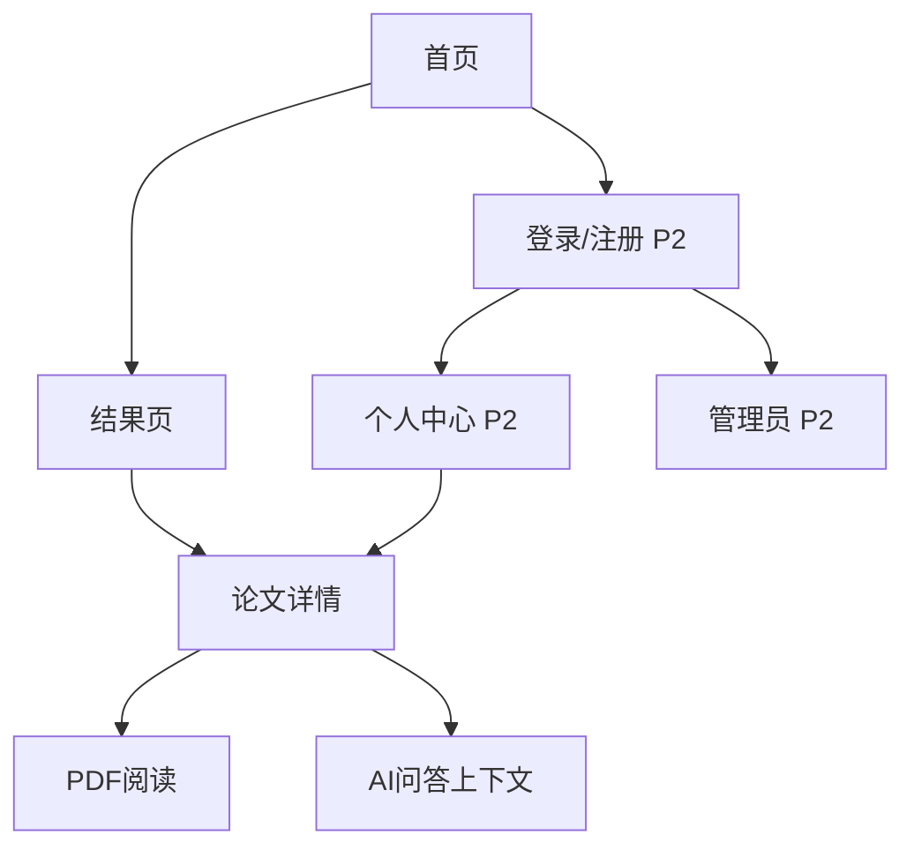

# 05 UI 规范与页面流程

## 1. 视觉基线

- 风格：现代科研工具，科技蓝主色、浅灰背景、白色卡片、清晰层级；禁止简单输入框+HTML 表格式布局。
- 设计令牌待组员 B 在会议后固化：主色、成功/警告/错误色、圆角、阴影、间距、字体和断点。
- 组件优先使用 shadcn/ui，列表、筛选器、标签、分页、Skeleton、Toast 和 Modal 统一交互；键盘焦点和对比度可见。
- 响应式：桌面双栏/三栏，平板折叠筛选，移动端单栏；长标题、摘要和错误信息可换行。

## 2. 页面规格

| 页面 | 布局与核心组件 | 输入 | 输出/状态 | 负责人 |
|---|---|---|---|---|
| 首页 `/` | 顶部品牌、搜索框、字段/模式选择、示例查询、统计卡片 | q、field、mode | 跳转结果页；空输入提示 | 组员 B |
| 结果页 `/search` | 查询摘要、筛选侧栏、排序、结果卡片、分页 | API search 参数 | 标题/作者/年份、摘要片段、高亮、分数、匹配解释 | B+组长 |
| 详情页 `/papers/:id` | 元数据卡、摘要/正文、PDF 预览、引用来源、收藏按钮 | paper_id | 加载/缺失/错误/无 PDF 状态 | B |
| AI 面板 | 问题输入、上下文范围、答案区、引用卡片 | question、paper_ids | 答案、citation、证据不足提示 | B+组长 |
| 个人中心 `/me` | 收藏、历史、偏好 | 登录态 | 空状态、分页、取消收藏 | B（P2） |
| 管理员 `/admin` | 上传队列、审核状态、错误信息 | 文件/审核动作 | 权限错误、上传进度、审核结果 | B（P2） |

## 3. 交互逻辑

1. 首页提交后将查询参数写入 URL，结果页可刷新和复制链接；输入建议为防抖请求，失败时不阻塞手动提交。
2. 切换 `keyword/semantic/hybrid` 时保留 q、分页重置为 1，并在结果顶部显示当前模式；模式分数不跨模式比较。
3. 结果卡点击标题进入详情，返回时保留筛选和滚动位置；PDF 缺失时提供“原文不可用”状态，不伪造下载。
4. 高亮内容仅来自 API 受控字段，前端需安全渲染；引用卡片点击 `paper_id` 回到详情并显示定位。
5. AI 请求期间显示取消/加载状态；`insufficient_evidence` 使用明确提示和检索建议，不显示确定性答案。

## 4. 页面状态清单

每个页面必须实现：初始加载、Skeleton、成功、空结果、网络错误、服务不可用、权限不足（适用时）、窄屏布局。Mock 阶段用 `status=mock` 徽标或开发提示，正式演示前移除或替换为真实状态。

## 5. 跳转关系

## 6. 验收

- 组员 B 交付页面走查截图/录屏、组件清单和 API Mock 映射；组长提供真实 API 或固定响应。
- 桌面宽度与移动宽度各走一遍首页→搜索→详情→问答；检查高亮、分页、错误、空状态、来源跳转。
- UI 变更不得修改公共 API 字段；需要新字段先更新 `04_API_CONTRACT.md` 并通知组长。

