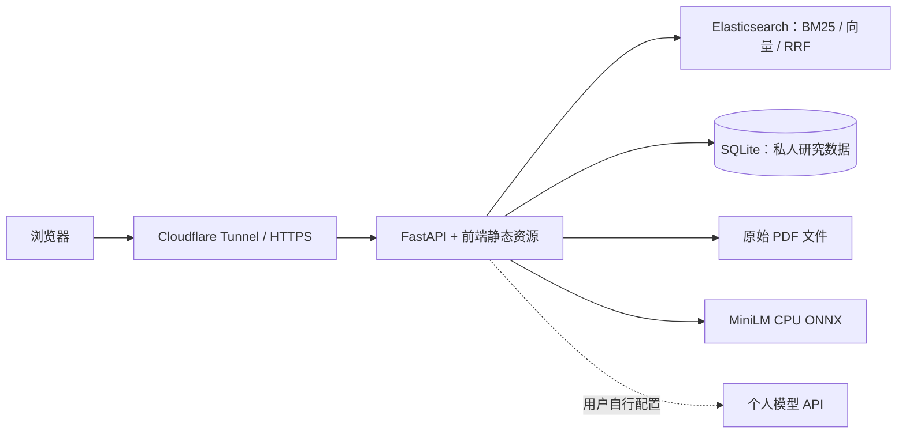

# ScholarLens 项目总报告

更新日期：2026-10-29（北京时间）。面向课程汇报、PPT 制作、项目交接和后续开发。当前应用基线为 `d7cfc56`；本次整理只修改文档，不改变网页外观、代码或正式数据。

ScholarLens 是信息检索课程的学术论文研究工作台，围绕“搜索 → 阅读 → 收藏与标注 → 核对证据”组织功能。它已连接真实论文、检索后端、账户数据库、原始 PDF 和服务器部署。模型服务由每位登录用户独立配置；没有模型也可以检索原文证据。

在线网站：[scholarlens.lingion.cc.cd](https://scholarlens.lingion.cc.cd/)。源码仓库：[Scarlett-web/scholarlens-ir](https://github.com/Scarlett-web/scholarlens-ir)，工作分支 `zjl`。配套 [PPT 逐页底稿](PPT_OUTLINE.md)、[文档导航](README.md)和[当前状态与证据](operations/STATUS.md)。

## 1. 项目目标、成果和贡献

### 1.1 为什么做这个项目

检索课程需要展示倒排索引、排序和评价方法；实际阅读又需要把搜索结果接到原文、笔记和可复核的结论。项目因此同时覆盖检索算法与使用流程，避免只做一个展示搜索结果的静态页面。

| 目标 | 实际交付 | 如何展示 |
| --- | --- | --- |
| 找到论文 | 六字段 BM25、语义召回、RRF 混合、建议与筛选 | 同一关键词切换三种模式 |
| 读到来源 | 元数据、摘要、正文窗口、原 PDF、专注阅读 | 打开一条真实结果，定位正文和 PDF |
| 留下研究记录 | 收藏、分类、笔记、历史、阅读位置、备份 | 收藏后进入“我的文献”继续整理 |
| 核对结论 | 原文片段、字符定位、引用逐字检查、执行轨迹 | 从助手来源回到原文 |
| 持续访问 | 账户权限、受审核上传、服务器、备份与回滚 | 公网打开网站，电脑关闭后仍可使用 |

### 1.2 已经拥有什么

| 资产 | 内容 | 事实来源与限制 |
| --- | --- | --- |
| 正式文献库 | 859 篇真实论文 | 本次公网 `/api/stats` 复核；不是 859 个演示样本 |
| 原始材料 | 原包 999 份 PDF；859 份对应正式检索库，合计 22,686 页 | [原件交付记录](operations/13_ORIGINAL_PDF_DELIVERY.md)；本次未重新全量下载和数页 |
| 向量库 | 49,420 个片段，384 维 | 本次公网 `/api/metrics`；片段数不等于论文数 |
| 前端 | React 18、Vite 6、TypeScript、React Router 7 | 页面和接口适配在 `frontend/` |
| 后端 | FastAPI 0.2.1、Python、Elasticsearch 8.19.23 | 本次公网 OpenAPI 为 65 路径、81 操作；不代表 81 条都在本轮端到端重测 |
| 用户数据 | SQLite，保存账户、收藏、笔记、历史、上传状态、通知和对话 | 正式用户库独立于应用源码；不上传 Git |
| 模型 | 本机 CPU ONNX MiniLM；可选个人大模型 API | 英文嵌入模型不等于中文/跨语言模型 |
| 网站 | 华为云 + systemd + Cloudflare Tunnel + HTTPS | 当前应用 release `20261029T022557Z-d7cfc56`，本次只读核实 |
| 工程交付 | 源码、协议、启动说明、审计工具、测试、归档与数据 Release | 克隆源码不会自动带上运行库、模型和原论文 |

### 1.3 “我们做了什么”和“我做了什么”如何表述

项目接收了数据组从原 PDF 处理得到的正式 JSONL 和来源清单，在其基础上完成校验、索引、服务、页面、交互、安全修复及线上交付。不要把接入组员数据写成“我重新解析了全部原包”。

| 阶段 | 完成的工作 | 可追溯产物 |
| --- | --- | --- |
| 规划 | 拆分需求、数据协议、API、页面与协作边界 | `docs/specs/01` 至 `06` |
| 数据验收 | 固定来源版本、字节保真、重复/缺失/乱码检查；20 篇先行，再全量导入 | 数据协议、数据验收历史、导入与质量脚本 |
| 检索服务 | 六字段 BM25、MiniLM 分块向量、RRF、发现、详情、全文和 PDF | `backend/app1.py`、`retrieval.py`、索引相关模块 |
| 业务后端 | 账户、工作区、会话、上传审核、独立增量索引、权限与恢复 | `accounts.py`、`workspace.py`、`uploads.py` |
| 前端集成 | 真实 API 适配、搜索/阅读/书架/账户/助手/评测/上传/审核 | `frontend/src/` |
| 使用体验 | 最近五篇、首屏搜索、字段高亮、作者展开、分页、PDF 下载、自然语言追问 | 各工作流规范及发布记录 |
| 视觉迭代 | 冰岛实景、可调白玻璃、3D 层叠卡、顶部 Dock、工具菜单、简化书架 | 2026-10-29 外观提交 `5412e2f` 至 `d7cfc56` |
| 模型兼容 | 两种协议、模型列表、真实连接测试、错误分类、慢模型超时 | `14f7d70` 及[助手修订验收](archive/releases-20261028-29/38_ASSISTANT_CHAT_AND_API.md) |
| 工程保障 | 身份隔离、迟到响应、原件校验、版本发布、备份回滚、限定范围测试 | 权限契约、验收记录、`infra/`、`tools/` |

建议汇报表述：“我们基于正式论文数据，完成了从检索、阅读、整理到证据核验的完整研究流程，并将系统部署到可持续访问的网站。”个人姓名、真实分工和贡献比例由本人按实际情况填写；AI 辅助实现与人工需求、评审、验收的关系按课程要求说明。

## 2. 系统结构和数据在哪里

### 2.1 整体架构

浏览器不直接连接 Elasticsearch 或 SQLite。前端资源与 `/api` 使用同一个域名。论文索引、用户库、PDF、模型与源码各自独立，因此更新页面不必覆盖论文或账户。

### 2.2 数据链路

`paper_id` 是稳定的来源标识。导入不覆盖原 JSONL；先写新代、数量核对成功再切 alias。严重乱码正文从可搜索文本隔离，元数据仍保留；不能将 partial 直接当作整篇不可用。

### 2.3 正式数据质量

2026-10-29 公网数据快照如下。完整日期与年份是不同字段，不以年份编造月日。

| 字段/状态 | 数量 | 可用于 PPT 的解释 |
| --- | ---: | --- |
| 有标题 | 859 / 859 | 100.00% |
| 有作者 | 857 / 859 | 99.77%，缺失不猜名字 |
| 有摘要 | 773 / 859 | 89.99% |
| 有机构 | 765 / 859 | 89.06%，不等于机构实体消歧完成 |
| 有地址 | 681 / 859 | 79.28% |
| 有完整日期 | 231 / 859 | 26.89%，另 628 篇缺完整日期 |
| 有年份 | 478 / 859 | 55.65%，另 381 篇缺年份 |
| 安全索引正文 | 855 / 859 | 99.53%；4 篇严重乱码正文隔离 |
| 解析状态 | success 215、partial 644 | 交付文件质量标记，不是上传流程成功率 |

当前基础 mapping 仍为 `papers-p0-v1`。后端已准备新代 `papers-v2-cjk`，本次没有重建或切换正式索引。原包、正式元数据与来源清单存于[独立数据 Release](https://github.com/Scarlett-web/scholarlens-ir/releases/tag/papers-originals-2026-10-28)，不混入源码历史。

### 2.4 数据库、浏览器与文件的职责

| 保存位置 | 保存内容 | 边界 |
| --- | --- | --- |
| SQLite `users`、`sessions` | 账户、角色、密码哈希、会话 token 哈希 | 密码使用 scrypt，不存明文密码/token |
| 收藏/分类/历史相关表 | 收藏、笔记、分类关联、搜索和浏览记录 | 只按当前用户读写 |
| 上传/审核/通知表 | 文件标识、状态、审核意见与通知 | PDF 本体在独立文件目录 |
| 对话/消息表 | 本人研究对话、消息和引用 | 管理员角色不赋予读取他人私人对话的权限 |
| 浏览器 `localStorage` | 游客工作区、阅读位置、外观设置、按用户隔离的 URL/模型偏好 | 不自动跨设备同步；不保存个人 API key |
| 标签页 `sessionStorage` | 网站登录 token、当前用户个人 API key | 退出/会话失效清除；不写到 Git 或 Vite 变量 |
| IndexedDB / Blob | 本地 PDF 工作区 | 与服务器上传、正式文库相互独立 |
| Elasticsearch | 正式与上传论文的关键词/向量索引 | 搜索索引不是用户数据库 |

表结构见 `backend/accounts.py`、`db_migrations.py`；跨设备研究空间依赖服务端同步，阅读滚动位置仍是当前浏览器状态。

## 3. 页面、功能和完整使用流程

### 3.1 路由地图

| 页面 | 路径 | 用户任务 |
| --- | --- | --- |
| 首页 | `/` | 首屏搜索、最近五篇真实阅读、进入研究空间 |
| 论文检索 | `/search` | 模式/字段/年份/排序/分页、打开结果 |
| 论文阅读 | `/paper/:paperId` | 摘要、正文、PDF、引用与选文笔记 |
| 探索论文 | `/explore` | 候选浏览、随机换批、真实字段关系图 |
| 我的文献 | `/library` | 收藏、分类、笔记、历史与备份 |
| 账户 | `/account` | 注册/登录/退出、资料、安全、通知 |
| 研究助手 | `/assistant` | 原文检索、个人模型问答、总结、比较、对话 |
| 检索评测 | `/evaluation` | 相关性标注、Precision/nDCG、导出 |
| PDF 工作区 | `/upload` | 本机 PDF 或 API 模式上传队列 |
| 审核工作台 | `/admin` | 按身份显示本地流程或服务端审核与管理 |
| 未知地址 | 404 | 明确反馈并返回检索 |

前端结构检查的“8 core routes plus 404”是该脚本的检查口径，不等于系统只有 8 个页面。

### 3.2 首页和最近阅读

首页直接输入关键词，可选择检索字段。最近阅读卡只使用实际打开过的论文，按最后访问排序、去重、最多五篇，不足五篇按真实数量显示；无历史显示引导，不用未读论文凑满。

卡片支持前后切换、页码与键盘；悬停、焦点、离屏、隐藏标签页、全站暂停和系统减少动态设置用于控制自动翻页。阅读记录不等于阅读完成率，装饰性 3D 图形也不代表学术指标。

### 3.3 搜索、高亮、作者和分页

输入支持标题、作者、日期、机构、地址、全文以及全部字段，并提供关键词、语义、混合三种模式。年份、排序、页码等条件进入 URL，便于返回和分享；切换筛选后回到第一页，非法页码做规范化。

高亮按实际命中字段呈现，服务端 `<em>` 只作为分段标记，前端渲染文本节点，不把结果当 HTML 注入。整句标题查询命中时，只在标题强调完整匹配，不把同一句里的每个词散落标亮在正文中；普通关键词和显式字段检索仍遵守自身范围。

多作者记录可以展开完整作者，不再只截取少数名字。页面已去掉用户指出的重复检索提示和检索分数说明；分页显示当前页附近的连续窗口，跳跃处有省略号。API 中保留 score 不等于页面必须展示它。

semantic 支持 all/title/fulltext；不能把作者、日期、机构、地址假装做成语义侧精确过滤。空查询页展示候选浏览，不把有限候选列表冒充全库搜索。

### 3.4 阅读、引用、PDF 与笔记

论文页查看元数据、摘要、正文窗口和质量状态，支持展开、全文查找、专注模式和阅读位置恢复。选中真实摘要/正文可以追加笔记，保留已有内容；笔记超限拒绝并提示，不静默截断。

正文窗口和引用位置按 Unicode 字符计数；前端负责转换为浏览器偏移。字符位置不是 PDF 页码，也不代表期刊印刷页码。保存的滚动位置由用户主动恢复，不自动把页面跳走。

当前页面下载按钮为**下载 PDF 原件**，继续使用后端受控文件路径和鉴权。原件支持在线阅读、独立窗口与 Range/206 下载。后端仍保留兼容 DOCX 转换 API，但它只导出提取文本，不能还原图片、公式、双栏；不要在 PPT 把它列为当前主要下载按钮。

### 3.5 探索和研究关系图

探索页展示真实候选并可换批。关系图只根据实际提供且规范化后相同的作者、机构等字段连边，最多显示 20 个节点；当前正式 API 不提供关键词/主题时不编造这些边。

同名作者不证明同一人，同机构不证明内容相似，关系图不是引用图谱。图基于 HTML/SVG 与 CSS 深度表现，按需加载；不需要常驻 WebGL 物理引擎。

### 3.6 研究书架、分类、历史和备份

支持收藏、分类创建/重命名/删除、论文归类、笔记和历史。删除分类保留收藏并回到未分类。最新外观把研究书架组织为整片磨砂玻璃，分类胶囊采用横向单行，论文与笔记便于并列查看。

游客使用本机空间；登录后读取本人工作区并同步服务端。首次读取失败显示错误和重试，不冒充“没有收藏”。写入失败保留已知数据和恢复草稿，可导出；不会自动用旧快照覆盖未保存编辑。

JSON 导入是明确提示后的工作区替换，不是无损合并。导出仅代表当前研究空间备份，不是服务器数据库全库备份。搜索历史、浏览历史、滚动位置含义不同。

### 3.7 账户、角色和安全

支持注册、登录、退出、个人资料、头像、改密、账户停用和通知。网页注册通过注册后再登录完成；服务端退出会撤销当前会话。改密、停用需要二次凭证，输错当前密码不会错误清除仍有效的登录态。

普通用户不能审核或管理他人。最后一名有效管理员有事务保护，不能通过并发停用/降级清空管理员。账户、上传、PDF、笔记与对话均在后端校验所有权，不能只靠隐藏按钮。

### 3.8 本地 PDF 与服务端上传

这两条流程必须分开汇报：本机 PDF 保存在浏览器中，本地“通过审核”不等于正式入库；API 模式由登录用户上传，管理员审核、处理并发布独立上传索引。

上传流程为 `pending → approved/rejected → processing → indexed/failed`。处理接口返回 202 只代表已接受，仍要等待状态变化。失败保留原件和旧索引；上传的关键词/向量代与基础 859 篇分离，不能覆盖正式文库。

2026-10-29 `/api/metrics` 的正式批准上传为 0。历史隔离测试证明了权限和处理链路，不能把它写成“已有生产用户成功入库若干篇”。扫描件无文本层仍需要 OCR，XML 原件尚未交付。

## 4. 检索方法和评测

### 4.1 三种模式各解决什么问题

| 模式 | 方法 | 适用场景 | 限制 |
| --- | --- | --- | --- |
| keyword | Elasticsearch 倒排索引、字段权重、BM25 | 标题、姓名、机构、明确术语 | 词面不重合可能漏召回 |
| semantic | MiniLM 编码查询与真实片段，余弦召回 | 英文近义表达、自然语言研究问题 | 当前模型主要面向英文；并非中文语义验收 |
| hybrid | 合并两路名次，RRF(k=60) | 结合词面与语义候选 | 不保证对所有查询都更好 |

基础 BM25 参数 `k1=1.2`、`b=0.75`。语义模型 `sentence-transformers/all-MiniLM-L6-v2` 固定 revision，CPU ONNX、384 维，分块版本 `chars900-overlap100-v1`。长文分块使结果可连接到具体来源，而不是只给整篇一个不可解释的分数。

RRF 使用 `sum(1 / (60 + rank_i))` 合并同一论文的各路名次，避免直接相加 BM25 和余弦分数。候选窗口、相似度和延迟有各自口径，不能拿不同模式 score 数值大小证明哪种更好。

### 4.2 评测已经实现什么

评测页对真实查询结果做 0/1/2 三级人工相关性标注，再计算 Precision 与 nDCG，支持结果 JSON 导出。尚未标注完整的前缀显示待完成，不制造随机分数或曲线。

本次公网 `precision_at_5` 和 `ndcg_at_10` 均为 null：已实现计算方法，尚无正式金标准查询集上的最终检索效果结论。正式实验应固定语料、查询集、人工标注、参数和运行条件，再比较三种模式；不能用单条成功查询推导提升百分比。

### 4.3 中文文献的准备与边界

后端新 mapping `papers-v2-cjk` 为新 generation 准备内置 CJK 辅助分词字段，遇到汉字可附加辅助查询并把高亮归回原字段。历史独立临时索引已覆盖中英混合、短语及多个字段；旧英文代继续兼容。

正式库尚未迁移到这个 mapping，也没有新增中文语料。后续中文接入应先检查 UTF-8、抽取文本和 OCR，再用独立 generation 验证关键词和高亮。中文/跨语言语义检索需要另选多语言模型和独立向量代，不能把 CJK 分词当成多语言向量已经完成。

## 5. AI 助手、证据和模型配置

### 5.1 用户怎么使用

进入研究助手，可直接检索真实论文片段。登录后点击“API 设置”，填写自己的公共 HTTPS Base URL、密钥、模型和协议，依次读取模型列表、测试连接、保存个人配置，再开始问答。

读取列表只证明模型目录可访问，保存只证明格式和会话配置就绪；“测试连接成功”才代表该模型完成了一次简短生成。服务商可用模型会变化，界面不会静默替换用户指定模型。

支持 Chat Completions 和 Responses。Responses 用于规划和回答，并设置 `store:false`。个人长回答读取时间至少 60 秒，但仍受 Agent 总计 120 秒预算约束；连接测试是 25 秒内的小请求。超时、模型不存在、认证失败、限流和格式错误给出独立脱敏提示，不归咎于用户问题格式。

### 5.2 回答、总结、比较和证据状态

| 场景 | 行为 | 必须保留的边界 |
| --- | --- | --- |
| 只查原文 | 不调用模型，返回真实来源片段 | 未配置共享模型仍可用 |
| 文献问答 | 先检索、核对来源，再生成并检查引用 | 文献事实必须有可回到原文的引用 |
| 普通自然语言/追问 | 不强制检索语法，可使用先前上下文 | 上下文不是新的论文证据 |
| 无本库依据的通用问答 | 可返回 general_answer，明确未由本库核验 | 无伪造引用，不能当文献结论 |
| 单篇总结 | 限定一篇论文 | 没有足够证据不假称已读完整论文 |
| 多篇比较 | 选择 2–10 篇且逐篇有证据 | 缺一篇不能冒充完整比较 |
| 保存对话 | 本人账户下创建、重开、删除 | 其他用户和管理员不能读取私人对话 |

### 5.3 Agent、MCP、Skill、Workflow 各是什么

| 名称 | 本项目的实际职责 | 不应夸大的部分 |
| --- | --- | --- |
| Agent | 在工具白名单与预算内规划、检索、整理证据 | 不是任意操作服务器的万能代理 |
| Workflow | 将规划、搜索、核对、回答与引用检查串为有限步骤 | 轨迹中 done 不等于学术结论天然正确 |
| Skill | 限制任务、工具、证据数和恢复次数 | 规则文件本身不是模型 |
| MCP | 提供局部 stdio 工具/资源/提示词接口 | 不是公开暴露整个服务器 |
| Harness | 隔离库和受控响应复现边界案例 | fixture 成功不等于真实供应商成功 |

实际预算包括最多 3 次查询、10 次工具调用、10 条证据、1 次修复、120 秒总预算。主 Agent 返回完整核验 JSON；旧兼容 SSE 先完成生成和核验再分段发送，不是上游逐 token 实时流式。

### 5.4 已经完成的真实供应商验收

2026-10-29 前次发布使用华为云应用代码和独立临时账户库验证：读取 26 个模型，指定 `gpt-6.1-sol` 在两种协议下均返回文字；自然语言问答返回通用回答且无伪造引用；单篇总结约 1052 字、3 条原文引用通过检查。详见[原始验收记录](archive/releases-20261028-29/38_ASSISTANT_CHAT_AND_API.md)。

这不是本次文档整理重新调用的结果，也不保证目录内所有模型都可用。截图中的旧 `gpt-5.5` 曾返回退役错误；不把这个错误解释成用户问题不规范。

公网 capabilities 中 `ai_qa=not_configured` 表示**全站默认共享 AI 未配置**，与“登录用户可使用自己的已验证 API”并不矛盾。密钥不会写入源码、文档、生产数据库或全站环境文件。本次不读取或重新配置用户密钥。

## 6. 最新外观和交互如何演进

### 6.1 当前版本是什么样

最新外观是冰岛冰川与海面实景、明亮白玻璃和蓝色强调。桌面主导航已由旧侧栏转到顶部 Dock；“研究工具”下拉支持悬停展开、离开延迟关闭、点击固定和选项跳转收起。当前总报告不再用旧侧栏截图代表最新页面。

| 区域 | 当前实现 | 对使用的作用 |
| --- | --- | --- |
| 背景/外框 | 冰川照片透出，减少多层重复玻璃边框 | 降低卡片堆叠感 |
| 三档材质 | 纯白通透 / 标准微霜 / 凝脂厚雾 | 新浏览器默认纯白通透，旧浏览器保留已有选择 |
| 主要操作 | 蓝色主按钮、轻量次按钮、按下和悬停反馈 | 搜索、发送和保存更容易区分 |
| 首页 | 3D 倾角、层叠最近阅读、首屏搜索 | 动效围绕已有任务，不制造研究数据 |
| 助手 | 大对话区、底部输入、工具按钮按需展开 | 回答获得主要空间，配置不长期占三列 |
| 我的文献 | 单片磨砂卡、横向分类胶囊和书架层级 | 论文与笔记关系更清晰 |
| 动效 | 暂停、减少动态、离屏/隐藏控制 | 用户可主动静止页面 |

### 6.2 可核对的外观提交

`5412e2f` 玻璃与 3D；`82bfdb7` 顶部 Dock；`32fda40` 纯白通透与配色；`e4b5ea8` 菜单悬停桥接；`40e1ee0` 点击固定菜单；`acc2e0f` 减少重复边框并扩大助手；`8f31e21`、`d7cfc56` 统一书架与分类胶囊。

本次仅据当前代码、提交和已有截图记录这一外观，不回退这些提交，不重新调整 CSS，也不重新构建前端。

### 6.3 PPT 素材使用

最新素材在 [2026-10-29 截图说明](assets/report-20261029/README.md)，展示顶部菜单和助手。旧 [2026-10-28 截图](assets/report-20261028/README.md)只用作历史对比或当时阅读功能的说明。

现有界面中的“18+”“毫秒级”等静态展示文字不作为汇报数据或性能证据；正式数据采用 `/api/stats`，速度结论需要注明测量环境与日期。这次不修改这些界面文案。

## 7. 质量、安全和已知限制

### 7.1 已修复的具体问题

| 问题 | 实现的处理 | 验证口径 |
| --- | --- | --- |
| 字段高亮混乱 | 六字段保留命中范围、整标题只强调标题 | 真实库与对应单元/浏览器历史验收 |
| 作者显示不全、分页跳号 | 展开作者、页码窗口与省略号 | 见检索整理发布记录 |
| 问题被限制成固定格式 | 自然语言、追问上下文、通用回答状态 | 保留引用与论文范围约束 |
| 模型协议/退役错误混淆 | 两协议、模型列表、真实测试、独立错误提示 | 已有真实供应商和受控错误测试 |
| 输错二次凭证误退出 | 区分凭证错误与真实会话失效 | 账户隔离用例 |
| 旧请求覆盖新身份/新筛选 | 身份与上下文边界隔离迟到响应 | 书架、上传、发现、证据等专项历史验收 |
| 数据读取失败被当成空记录 | 保留已知数据、失败提示、恢复草稿 | 不自动覆盖未同步编辑 |
| 发布混入 demo 包 | 正式构建标记和逐资源哈希 | 普通 build 不当生产发布入口 |

安全措施包括个人响应 no-store、同源静态托管边界、安全响应头、PDF 受控读取、私网和重定向拒绝、个人 API DNS 固定与 TLS 校验、上游错误脱敏、数据库一致性备份。它们是具体工程措施，不是绝对安全或第三方安全认证。

### 7.2 测试数字怎么讲

| 证据 | 时间/范围 | 可以证明什么 |
| --- | --- | --- |
| 前端 38 项、结构、类型与生产构建 | 最近助手版本及后续外观提交中的已有记录 | 对应源码和当次构建；本次整理未重跑应用全套 |
| 后端 72 项 | 前次协议和个人 API 相关测试 | 请求隔离、两协议、响应与凭证边界等限定范围 |
| 后端 135 项、桌面 44 组、关系动效 13 项 | 2026-10-28 独立审计 | 当时版本的指定路径；不能合计成唯一用户场景数 |
| 真实供应商生成 | 独立临时账户库、指定接口/模型 | 实际文字与原文引用链，不覆盖全部供应商 |
| 本次公网只读快照 | 2026-10-29，当前 release | 正式论文数、模型/索引指标、能力、OpenAPI、构建资源 |
| 本次文档检查 | 迁移路径、链接、非文档文件哈希和服务状态 | 文档整理完整性，外观/运行程序未被本次改变 |

旧 Lighthouse 四项 100、依赖公告 0、ZAP 被动检查等仅能带原日期和环境引用，不能当作 2026-10-29 公网最新全面验收。失败记录和依赖未就绪记录保留在归档中。

### 7.3 仍未完成或需要独立验证

邮件网关与真实投递未验收；原始 XML 未交付；中文正式语料导入、多语言语义模型与正式重建未做；未建立最终相关性金标准和检索提升比例；生产并发容量与完整无障碍验收未完成。

GitHub Actions 跨平台方案仍是草稿，不能把本机测试当成已通过托管 CI。完整扫描件 OCR、复杂公式/版式恢复不是现有文本转换能力。个人 API 在每个浏览器仍需本人配置，测试记录不意味着默认全站共享。

## 8. 部署、同步、备份和恢复

应用运行在既有华为云服务，由独立 systemd 管理；Cloudflare Tunnel 提供域名和 HTTPS，关个人电脑不影响网站。API、ES 仅监听服务端回环地址，运行数据与代码分开放。

应用发布使用版本化 release 和 current 指向，前端 `build:production` 固定同源 `/api` 并生成构建清单。切换前保留上一 release、SQLite 一致性 backup、环境副本和回滚路径。只重启本应用，保留原件、索引、模型、用户以及其他服务。

本次是**文档同步**：推送整理后的 Markdown 和文档素材到 `origin/zjl`，服务器保留原文档备份后，将同一批文件同步到独立文档版本目录，以 `/opt/scholarlens/documentation/current` 为入口。不切换应用 release、不重建前端、不更改环境、数据库和索引、不重启服务。文档提交号与运行中的应用提交号可以不同，应分别记录。

日常运行、依赖和备份恢复见[后端启动手册](development/backend/BACKEND_STARTUP.md)、[部署说明](operations/11_SERVER_DEPLOYMENT.md)。数据原件恢复见[交付说明](operations/13_ORIGINAL_PDF_DELIVERY.md)。不要直接对生产库运行历史测试、导入或索引回滚命令。

## 9. PPT 制作、演示和答辩

### 9.1 可直接放在开头的项目摘要

ScholarLens 是面向学术论文的信息检索与研究工作台。项目以 859 篇真实论文和原始 PDF 为基础，使用 Elasticsearch 实现六字段 BM25，以 MiniLM 片段向量支持语义召回，并用 RRF 融合排名。在此基础上连接原文阅读、收藏笔记、账户隔离、受审核上传与可回溯的证据助手。前端采用冰川白玻璃与桌面顶部导航；网站部署于华为云，经 Cloudflare HTTPS 持续访问。项目已完成限定范围的接口、交互、供应商与发布验证，并明确保留中文语义、邮件、正式相关性评测和并发容量等后续工作。

### 9.2 建议的 8–10 分钟演示

| 时间 | 动作 | 讲述内容 |
| --- | --- | --- |
| 0–1 分钟 | 打开网站首页 | 真实文库、顶部 Dock、搜索和最近阅读 |
| 1–3 分钟 | 搜索 `magnetic`，切换字段/模式 | 条件、排名、高亮和分页；不直接比较不同分数 |
| 3–5 分钟 | 打开论文，阅读正文、PDF、收藏和笔记 | 真实原件与提取文本的区别 |
| 5–6 分钟 | 查看“我的文献” | 分类、笔记和真实浏览记录 |
| 6–8 分钟 | 助手“只查原文”，打开引用来源 | 模型不是必要前提，结论需要证据 |
| 8–9 分钟 | 已准备好个人配置时再演示问答 | 不展示密钥，失败如实说明 |
| 9–10 分钟 | 展示评测和上传状态图 | 指标需标注；上传需审核并完整索引 |

展示前用自己的专用演示账户检查，不借用生产用户数据，不把测试回答当成真实研究结论。模型未就绪时走原文检索主线。

### 9.3 常见答辩问题

| 问题 | 建议回答 |
| --- | --- |
| 和普通搜索框有什么不同？ | 除排序外，结果连到真实原文、私人整理和可逐字核验的证据。 |
| 为什么用三种模式？ | 词面精确和近义表达各有优势，RRF 提供可解释的融合；效果仍需同一标注集比较。 |
| AI 会不会乱编？ | 文献回答有来源和引用检查；通用回答明确未由本库验证。校验降低问题，不保证所有回答永远正确。 |
| 是否支持中文？ | 新代关键词 CJK 已准备并做独立测试；正式中文语料和多语言向量还未发布。 |
| 为什么 capabilities 的 AI 未配置？ | 那是全站共享默认值；每个登录用户可以独立配置本人 API。 |
| 999 和 859、49,420 有什么区别？ | 分别是原包 PDF、正式检索论文、向量片段，不是互相矛盾的论文总量。 |
| 页面 3D 是什么技术？ | 主要是 CSS 3D、SVG 和事件驱动交互，不是新建了 3D 数据库或物理引擎。 |
| 检索效果提高多少？ | 尚无正式金标准对比结论，不编造提升比例；已有标注和评价工具可继续实验。 |

### 9.4 后续工作顺序

先补固定查询集、相关性标注和可复现实验；再接中文正式数据与独立多语言向量；随后完成邮件与 OCR 条件、托管 CI、可访问性及并发容量验证。新数据和模型先走独立代与验收，不直接覆盖当前正式库。

## 10. 去哪里查细节

| 目的 | 入口 |
| --- | --- |
| 直接制作 PPT | [逐页底稿](PPT_OUTLINE.md) |
| 看本次事实和验证日期 | [当前状态](operations/STATUS.md) |
| 查看需求/架构/数据/API/UI | [技术规范目录](README.md#技术规范) |
| 安装、启动、配置、恢复 | [操作与开发手册](README.md#操作与开发手册) |
| 了解模型协议/密钥边界 | [个人 API](development/frontend/AI_API_INTEGRATION.md)、[后端 AI](development/backend/AI_CONFIGURATION.md) |
| 查历史改动/失败/旧验收 | [历史记录](archive/README.md) |
| 维护文档目录和同步规则 | [文档维护记录](operations/DOCUMENTATION.md) |

本文件是“现在做成什么、有什么、如何汇报”的总入口；技术细节以对应规范和当前实现为准，历史结论保留日期，不覆盖后续事实。
