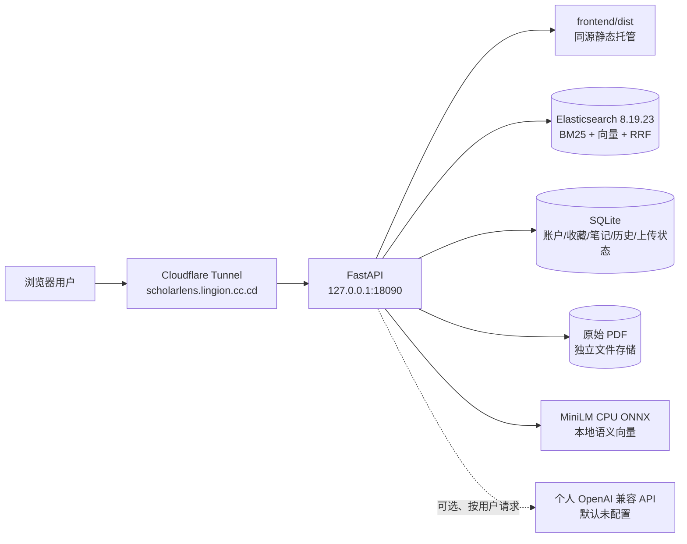
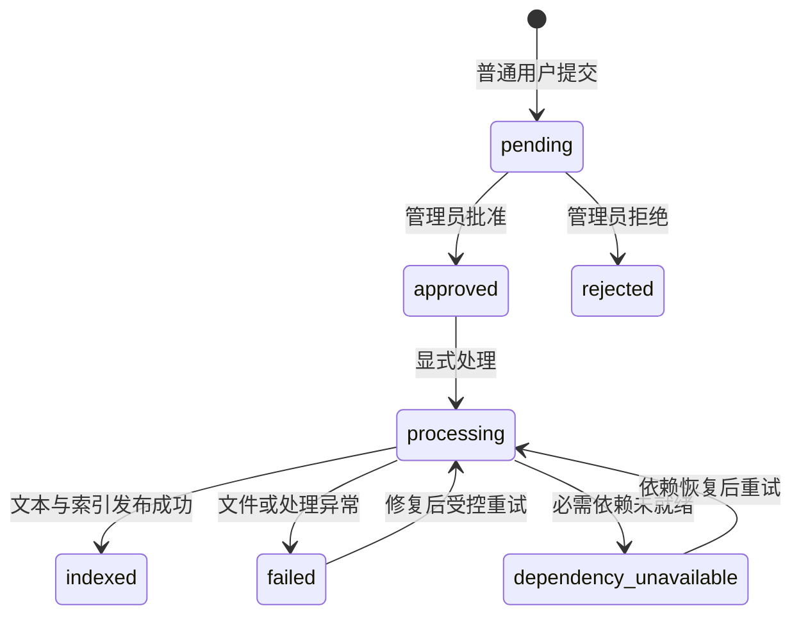
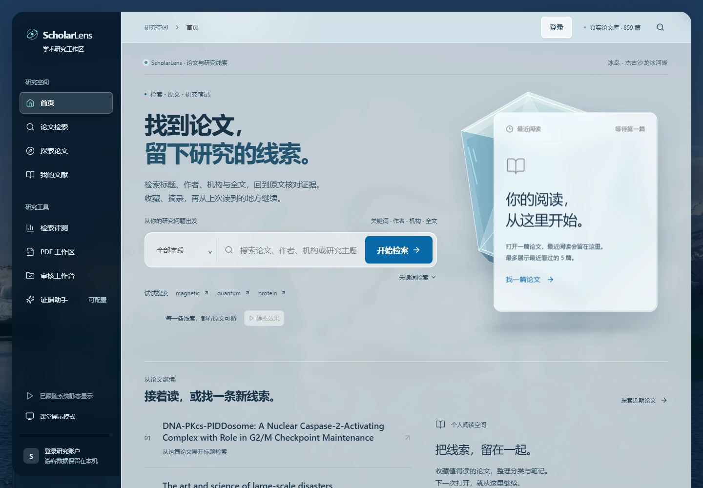
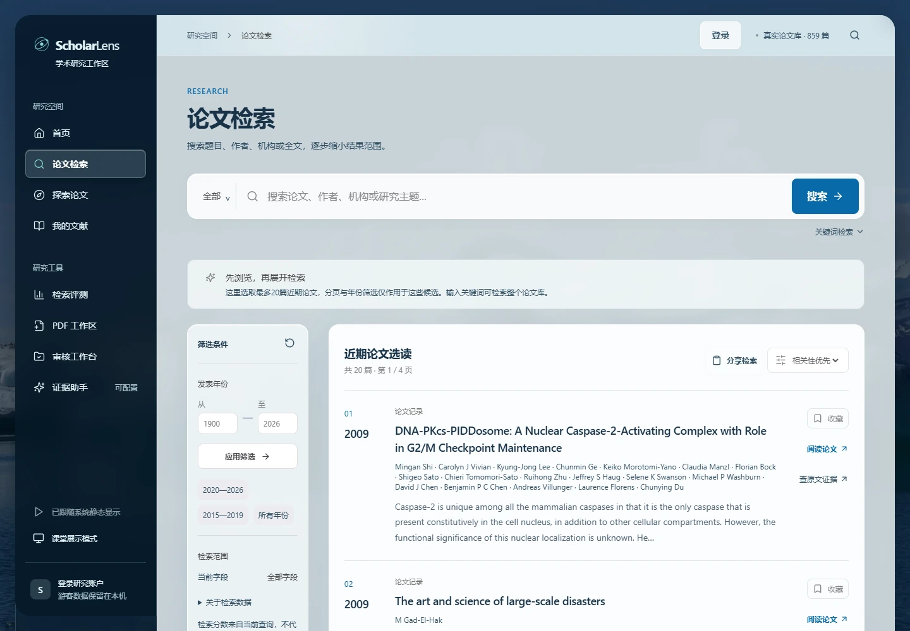
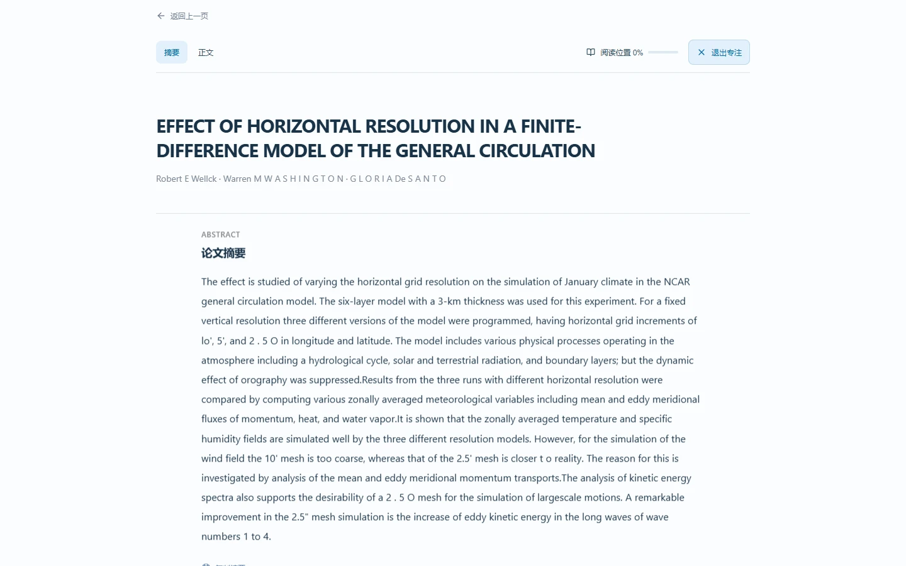

# ScholarLens 项目总报告与汇报底稿

> **用途**：这份文档按“可以直接拆成课堂 PPT”的方式整理。它描述截至 **2026-10-28** 已经落地、已经验证、仍有边界的内容；历史快照不覆盖当前结论，Mock/fixture 不冒充真实业务结果。
>
> **一句话介绍**：ScholarLens 是一个面向学术论文的研究工作台，把真实论文数据、关键词/语义/混合检索、原文阅读、收藏笔记、证据定位、个人账户和受审核上传流程放到同一个可访问网站中。
>
> **阅读建议**：先读第 1–3 节把握项目，第 4–8 节制作技术与成果页，第 14–23 节查逐功能细节、算法、数据、贡献与证据。配套 [PPT 逐页底稿](PPT_OUTLINE_20261028.md)提供页面文字和讲稿。[文档索引](README.md)集中维护当前入口。

## 1. 项目要解决什么问题

传统的课程检索作业往往只能展示一个搜索框和几条静态结果，用户无法回答“这篇论文从哪里来、原文在哪、我看过什么、能不能复现”这些问题。本项目把目标拆成五层：

1. **找到**：让用户按标题、作者、日期、机构、地址、正文等字段搜索论文，同时支持关键词、语义和混合检索。
2. **看懂**：从搜索结果进入详情、摘要、正文片段、原文 PDF，并能在阅读时保持位置和专注状态。
3. **留下痕迹**：收藏论文、分组、记笔记、记录最近搜索和最近阅读，下一次打开仍能继续研究。
4. **证明结论**：证据助手只从真实论文片段中返回引用，支持字符范围定位、原文核验和引用复制；没有模型也能使用证据检索。
5. **可持续运行**：登录账户、权限隔离、上传审核、独立增量索引、备份回滚、服务器部署和公开访问形成闭环。

## 2. 现在手里有什么

| 资产 | 当前内容 | 可以怎么展示 | 证据/边界 |
| --- | --- | --- | --- |
| 公网网站 | `https://scholarlens.lingion.cc.cd/`，华为云部署，电脑关闭后仍可访问 | 现场打开首页、搜索、论文详情 | 当前线上 release 为 `20261028T090257Z-42c81c9` |
| 前端 | React 18 + Vite 6 + TypeScript + React Router 7，桌面优先的冰岛玻璃视觉 | 展示首页、搜索、阅读、书架和账户 | `frontend/src/App.tsx` 路由包含 `/`、`/search`、`/paper/:paperId`、`/explore`、`/library`、`/account`、`/assistant`、`/evaluation`、`/upload`、`/admin` |
| 后端 | FastAPI/Python 3.11+，同源 `/api`，Swagger `/docs` | 打开 `/api/stats`、`/api/capabilities` | API、ES、SQLite 独立；外网不暴露 ES/SQLite |
| 论文库 | 859 篇真实论文；公开检索、详情、正文、PDF 阅读/下载已接通 | 搜索 `magnetic`，打开真实论文，查看 PDF | 859 份正式库原始 PDF 共 22,686 页；完整 999 份原包放在独立 GitHub Release，不进源码 Git 历史 |
| 索引 | Elasticsearch 8.19.23；BM25 倒排、CPU MiniLM 语义向量、RRF 混合 | 切换三种检索模式并对比结果 | 语义/混合在小服务器上 CPU 成本较高；没有做并发压测 |
| 用户空间 | 注册、登录、退出、会话撤销、资料、头像、改密、停用、通知、收藏、分类、笔记、历史、备份 | 注册两个账户，证明数据隔离 | 真实隔离账户与 SQLite/浏览器流程已验收；不公开生产用户信息 |
| 研究助手 | 证据检索、引用逐字核验、字符定位、执行轨迹；URL/模型偏好按账户存本浏览器，密钥只存标签页会话 | 未配置模型时演示证据检索；有配置时再调用兼容接口 | 真实供应商没有配置，不能宣称模型生成已验收 |
| 上传工作流 | 登录上传 → 管理员审核 → 解析 → 独立增量索引 → 检索/下载/归档 | 演示状态流和权限边界 | 真实 ES + MiniLM 隔离链通过；合成 PDF 只证明工作流，不等于正式语料解析质量 |
| 运行与发布 | systemd API、Cloudflare Tunnel、版本化 release、SQLite 一致性备份、回滚脚本 | 展示部署拓扑和回滚路径 | Tunnel 与 ES 未被本次发布重启；上一 release 保留 |
| 质量证据 | 前端 35 tests；后端 10 个独立模块 135 项；Chrome/Edge 44 组桌面回归 | PPT 放数字、报告路径和边界 | 具体报告在 `tools/audit/reports/` 和外层忽略 `output/`，不把报告运行文件提交 Git |

## 3. 用户能做什么

### 3.1 游客主流程：搜索 → 阅读 → 保存

1. 在首页输入关键词，搜索建议来自真实标题/作者前缀，不编造热词。
2. 在搜索页选择字段、年份范围、排序方式、分页和检索模式；已选条件可逐个移除，失败时保留当前上下文并重试。
3. 从结果行打开详情，查看标题、作者、日期、机构、地址、摘要、正文窗口、质量状态、来源信息和可用操作。
4. 在阅读页使用全文查找、折叠、专注模式、滚动位置恢复、引用复制和原文 PDF；阅读区使用实色纸面，背景玻璃只承担导航和层次。
5. 登录后收藏论文、创建分类、添加笔记，继续阅读入口只来自真实浏览历史；没有记录就显示空状态，不伪造阅读进度。

### 3.2 账户与安全

- 注册不自动授予管理员权限；注册接口仅创建账户，网页注册流程随后调用登录接口；密码有长度和格式约束。
- 登录返回 Bearer token；服务端只存 token 哈希，退出会撤销当前 token。
- 修改密码需要当前会话和二次凭证；输错当前密码不会误清除仍有效的前端会话。
- 停用账户会撤销全部会话但保留个人资料和研究数据；最后一名有效管理员不能被并发操作清空。
- 个人 API URL、模型及 token 参数偏好按用户 ID 保存在本浏览器 `localStorage`；密钥只在当前标签页 `sessionStorage`，退出/会话失效清除密钥。密钥不进 SQLite、Git、Vite 环境变量或日志；偏好不等于跨设备配置同步。

### 3.3 管理员与上传者

- 普通用户只能看自己的上传记录；管理员才可审核、处理和归档。
- 上传状态是 `pending → approved/rejected → processing → indexed/failed`。
- 处理返回 `202` 只代表任务已接受，前端轮询状态；不能把 202 当成“已经进入检索”。
- 上传索引使用独立 alias 和 generation，不覆盖 859 篇基础库；失败保留原件和旧索引。

## 4. 系统架构



### 4.1 前端层

前端以 React 组件组织页面，React Router 负责深链接，canonical CSS 集中维护颜色、间距、圆角和材质。当前视觉方向是浅色、系统字体、冰岛照片、透明玻璃导航和明亮纸面阅读区；动画只用于轻量路由转场、视差和状态反馈，并受暂停按钮与 `prefers-reduced-motion` 控制。

关键页面：

| 路径 | 页面职责 | 汇报演示点 |
| --- | --- | --- |
| `/` | 首页和最近阅读 | 首屏搜索、冰晶视觉、最多五篇真实最近阅读 |
| `/search` | 关键词/语义/混合结果 | 字段、年份、分页、排序、高亮、重试 |
| `/paper/:paperId` | 论文详情和阅读 | 关系图、摘要/正文、专注模式、位置恢复、PDF |
| `/explore` | 发现和随机换批 | 真实候选、换批、错误节点和重试 |
| `/library` | 研究书架 | 分类、收藏、笔记、备份导入导出 |
| `/assistant` | 证据台和个人模型配置 | 无模型也可证据检索，引用逐字核验 |
| `/evaluation` | 检索评测 | 人工标注、Precision@5/nDCG 计算边界、JSON 导出 |
| `/upload` | 个人上传队列 | 状态、筛选、失败保留、轮询 |
| `/admin` | 管理员工作区 | 用户管理、审核队列、最后管理员保护 |

### 4.2 API、检索和数据层

- **关键词**：六字段 BM25，标题权重最高，支持短语、模糊、年份筛选、稳定排序和高亮。
- **语义**：MiniLM CPU ONNX 对标题、摘要和安全正文分块编码，按 cosine 相似度召回。
- **混合**：先得到关键词排名和向量排名，再用 Reciprocal Rank Fusion 合并；不直接比较两种分数。
- **数据状态**：`real`、`mock`、`dependency_unavailable` 等状态从 API 返回，前端不从按钮存在推断能力已就绪。
- **详情/正文**：正文按 Unicode 字符窗口读取；`offset` 不是 PDF 页码，也不是 JS UTF-16 偏移。
- **PDF**：支持 Range/206 和 `Content-Range`，不把本地磁盘路径暴露给前端。

## 5. 数据从哪里来，如何保证可追溯

正式论文的元数据来自论文 PDF 的解析结果，`paper_id` 使用稳定来源哈希。导入过程不会静默修改原 JSONL：

1. 读取 JSONL，检查 BOM、字段类型、重复 ID、日期/年份冲突、未知字段和正文乱码。
2. 把 `partial` 记录保留为可检索元数据；`error` 记录隔离；没有状态的记录记为 `unknown`。
3. 生成新的 index generation，bulk 写入全部成功且数量校验通过后才原子切换 alias。
4. 旧 generation、原始 JSONL、来源 CSV 和 PDF 原件保留，失败时不切换当前 alias。

原 PDF 交付边界要单独讲清：正文 JSONL 是解析结果，不能还原原排版；现在正式库 859 份 PDF 已可在线阅读和下载，完整原包及元数据在独立数据 Release。XML 没有交付，但 PDF 阅读不依赖 XML。

## 6. 研究助手、Agent、MCP、Skill、Workflow 的真实含义

这部分容易在 PPT 中被说得过大，建议按“它们分别负责什么”讲：

| 名称 | 在本项目中的实际角色 | 已证明什么 | 没有证明什么 |
| --- | --- | --- | --- |
| Skill | 约束任务范围、工具白名单、输出格式和恢复策略 | 运行契约能限制查询、证据数、修复次数 | 不是一个自动产生正确答案的模型 |
| Workflow | 把搜索、来源核验、回答/引用校验串成有限步骤 | 轨迹记录真实开始/结束、状态和结果数 | 不等于每次都能生成回答 |
| Agent | 接受问题后规划检索、执行白名单工具、整理证据 | Agent Harness 11 例；无模型时仍能证据检索 | 当前没有真实个人供应商生成验收 |
| MCP | 提供局部 stdio 工具、资源和提示词接口 | 3 个工具、2 个资源、1 个提示词已接入局部运行 | 不是把整个服务器暴露给模型 |
| Harness | 用隔离 SQLite、HTTP mock 和合成响应复现异常/边界 | JSON 形状错误、引用不匹配、迟到响应、权限隔离可复现 | fixture 不代替公网、真实账户或供应商 |

证据助手的安全闭环是：检索真实片段 → 保存 paper/chunk/locator → 模型回答后逐字核验 quote → 核验失败只显示来源，不显示未验证草稿。没有 API 配置时，用户仍可以执行真实证据检索；`/api/ask` 在未配置模型时会如实返回 `ai_not_configured`。

## 7. 这次具体做了哪些改进

### 7.1 功能完整性

- 把页面从单纯搜索扩展为搜索、阅读、书架、账户、上传、管理员、评测和证据台。
- 接通真实 859 篇论文、三种检索模式、建议/发现/随机换批、详情/正文/PDF。
- 增加登录、注册、退出、资料、头像、改密、停用、会话撤销和角色权限。
- 增加收藏、分类、笔记、历史、备份导入导出和本机阅读位置。
- 增加上传审核、解析、增量索引、归档和所有权检查。

### 7.2 体验与界面

- 登录页改为更明确的表单层级：密码显示、Caps Lock 提示、提交中状态、站内返回地址。
- 首屏搜索框在桌面首屏可见；最近阅读只显示实际看过的最后五篇，不制造阅读统计。
- 详情页处理长 source ID、窄屏溢出、关系图 focus 切换和 21→20 节点聚焦边界。
- 失败状态不再把“加载失败”写成“空列表”：发现、上传、书架、历史和证据都保留上下文与重试入口。
- 420ms 路由转场、冰晶/视差和玻璃层受暂停及减少动态控制；阅读正文保持清晰实色纸面。

### 7.3 稳定性与安全

- 统一 API 错误结构、私有响应 `no-store`、同源 CSP、资源安全响应头和 PDF Range 兼容。
- 修复最后管理员并发降级/停用导致管理员归零的问题。
- 修复迟到请求回填新账户、旧 focus、旧上传预览和新筛选上下文的问题。
- 个人模型连接限制为公共 HTTPS、固定 DNS/IP、TLS 校验、禁止跳转和私网目的地。
- 依赖与密钥边界明确：源码不含数据库、原件、模型、日志、运行报告和真实配置。

## 8. 验收与证据

### 8.1 通过的检查

| 检查 | 结果 | 证据范围 |
| --- | --- | --- |
| 前端单元/结构/类型/生产构建 | 35 项前端测试、结构、TypeScript、`build:production` 通过 | 当前生产源码和构建 manifest |
| 后端独立模块 | 135 项通过，约 95.88s | `tools/audit/reports/ci-final-retry-20261028/junit.xml` |
| 浏览器桌面回归 | Chrome/Edge 1440/1366，共 44 组；每浏览器 19 个真实论文内链 | `desktop-quality-2026-10-28T08-50-02-819Z-152b078c` |
| 关系图与动效 | 13 项通过 | `relation-motion-2026-10-28T08-46-26-907Z-0ff03011` |
| 上传工作流 | 刷新 503 保留旧记录、重试、身份清除、迟到预览隔离 | `upload-workflow-2026-10-28T08-51-07-924Z` |
| 证据台 | 证据定位、脱敏原因、失败保留 | `evidence-workflow-2026-10-28T08-52-40-053Z` |
| 账户安全 | 真实隔离 SQLite/浏览器：注册、登录、改密、停用、旧会话失效、Blob PDF | `account-security-2026-10-28T09-00-53-961Z` |
| 依赖 | npm 公告 0；48 个 Python 锁定依赖公告 0；49 包 `uv pip check` 通过 | `dependencies-final-20261028` |
| 被动检查 | ZAP 2.17 隔离 8 个固定 GET 通过；缺失 CSP 已修复 | `zap-passive-20261028-165002-6029590d` |
| 桌面性能 | Lighthouse 传统四项均 100；LCP 约 0.60–0.64s，TBT 0–7ms，CLS 约 0.000095 | `performance-final-20261028/desktop-*.json` |
| 公网只读 | 859 篇、真实机构字段、Agent 5 段来源且 `model=not_called`、PDF Range/哈希、资源哈希 | `output/parallel-release-20261028/` |

### 8.2 必须诚实说明的边界

- GitHub Actions 三平台工作流只是草稿，OAuth 缺少 `workflow` scope，未运行。
- 个人 AI URL/模型/密钥接口保留，但没有真实供应商密钥，因此没有“模型生成成功”证据。
- 邮件服务接口保留，真实邮件投递未验收。
- XML 未交付；正式 PDF 已接入，但不代表所有 OCR/扫描质量或每个客户端 PDF 内核都完美。
- 语义/混合顺序测量约为关键词 17.21ms、语义 2369.44ms、混合 2659.58ms；这是小服务器 CPU 的三次顺序测量，不是并发压测。
- ZAP 仍提示 `style-src unsafe-inline`，这是 React 动态 style/3D 布局的已知折中，不应在 PPT 中写成“零安全告警”。
- 全键盘、全读屏、跨设备同步、整机断电重启、全部正式上传解析质量和长期容量仍需后续验收。

## 9. 部署、回滚与日常维护

线上发布采用版本目录而不是覆盖运行目录：

1. 本地生产构建并生成资源 hash。
2. 服务器建立新 release 目录，复制源码构建物；保留 `current` 指向旧版本。
3. 备份 SQLite 一致性副本和环境副本；不覆盖发布后的用户操作。
4. 切换 `current`，重启 `scholarlens-api`，Cloudflare Tunnel 和 Elasticsearch 保持原实例。
5. 公网只读检查首页、`/api/stats`、`/api/capabilities`、真实搜索、PDF Range、资源 hash；失败就切回上一 release。

当前 release：`/opt/scholarlens/releases/20261028T090257Z-42c81c9`；上一 release：`/opt/scholarlens/releases/20261028T074402Z-6c9eaa7`；备份目录：`/opt/scholarlens/backups/20261028T090257Z-42c81c9/`。这些服务器路径只用于维护。PPT 无需展示真实环境文件、账号、凭据或数据库内容。

## 10. 可继续迭代的路线

### 近期

- 把 GitHub Actions 草稿在获得正确 OAuth scope 后启用，并保留三平台只读权限。
- 补齐全键盘/读屏清单和更多浏览器内置 PDF 行为检查。
- 对语义/混合检索做并发、缓存和索引优化，避免用视觉效果掩盖 CPU 延迟。
- 明确管理员首次指定、邮件网关、XML/GROBID 的产品决策和验收入口。

### 中期

- 为上传论文增加正式语料解析质量仪表盘和失败重试队列。
- 建立人工标注集，正式计算 Precision@5、nDCG@10 和不同模式的延迟分布。
- 支持更清晰的引用导出格式和研究项目级备份。

### 不应直接做的事

- 不把个人 API 密钥写进 Vite 环境变量、GitHub、SQLite 或 PPT。
- 不把 synthetic fixture、Mock 论文或一次 HTTP 200 写成真实业务成功。
- 不为了“看起来完成”删除原件、数据库、旧 release、失败报告或回滚副本。

## 11. 课堂现场演示脚本（8–10 分钟）

1. **30 秒**：打开公网首页，说明项目不是广告页，而是研究工作台。
2. **90 秒**：搜索 `magnetic`，切换关键词/语义/混合，展示字段、年份、分页和高亮。
3. **90 秒**：进入一篇论文，打开专注模式，滚动后刷新/返回，展示位置恢复和 PDF。
4. **60 秒**：登录后收藏、建分类、写一条笔记，返回书架。
5. **90 秒**：打开助手，先用无模型证据检索，点开引用定位；说明真实 AI 仍由每位用户独立配置。
6. **60 秒**：展示上传状态流和管理员审核边界；强调上传索引不覆盖基础 859 篇。
7. **60 秒**：展示 `/api/stats`、架构图和测试数字。
8. **30 秒**：主动说清未完成边界：邮件、真实供应商、CI、并发容量、全无障碍和 XML。

## 12. 答辩高频问题与回答

**问：为什么同时做 BM25、语义和混合？**

答：BM25 对精确词和字段过滤可解释，语义检索能找到词面不同但含义接近的片段，RRF 把两路排名合并而不要求把分数强行放到同一尺度；三种模式可以直接对比。

**问：你们的 AI 是不是已经接通？**

答：证据检索和引用核验已经能在无模型状态运行；个人 API URL、模型和密钥配置入口已保留且按用户/标签页隔离，但当前没有真实供应商密钥，所以不把模型生成写成已验收。

**问：JSONL 是不是 PDF？**

答：不是。JSONL 是从 PDF 得到的结构化元数据和正文；当前正式库的原始 PDF 已独立存储并能通过 Range 接口阅读/下载，完整原包放数据 Release，XML 仍未交付。

**问：如何证明不同用户互相看不到数据？**

答：服务端每个个人资源按当前会话用户过滤，上传/PDF/DOCX/对话/收藏/历史均有所有权检查；真实隔离 SQLite 和浏览器流程覆盖注册、登录、改密、停用、迟到响应和管理员边界。

**问：为什么不直接把所有东西放进 Git？**

答：数据库、原始 PDF、模型和密钥体积大且包含运行/隐私状态；源码仓库保留可复现代码、契约、脚本和摘要，原件用独立 Release，服务器用版本 release、备份和回滚。

## 13. 文档导航

- 需求/架构/数据/API：`docs/01_REQUIREMENTS.md`、`02_ARCHITECTURE.md`、`03_DATA_SCHEMA.md`、`04_API_CONTRACT.md`
- 部署/交付：`docs/11_SERVER_DEPLOYMENT.md`、`docs/12_RELEASE_ACCEPTANCE.md`、`docs/13_ORIGINAL_PDF_DELIVERY.md`
- 运行契约与审计：`docs/18_AGENT_RUNTIME_CONTRACT.md`、`docs/29_GOAL_REQUIREMENTS_AND_EVIDENCE.md`、`docs/32_CONTINUOUS_VERIFICATION.md`、`docs/33_PASSIVE_CHECKS_AND_RESIDUALS.md`
- 功能契约：`docs/22_RESEARCH_MAP_AND_METRICS.md` 至 `docs/31_ISOLATED_UPLOAD_AND_OWNERSHIP.md`
- 过程快照：`docs/archive/20261028-process-notes/README.md`

## 14. 本轮编写报告时重新核对的在线数据

本节是**本轮文档整理期间的只读实测**。第 8 节的测试套件数字来自 2026-10-28 已保存的报告，本轮没有重复运行后端全量、扫描生产或写入账户。

| 检查入口 | 本轮观察 | 可以得出的结论 |
| --- | --- | --- |
| `/api/stats` | `papers=859`、`indexed=859`、`status=real` | 正式统计来自当前真实索引 |
| `/api/stats` 解析标记 | success 215、partial 644、failed 0、unknown 0 | 交付文件有明确质量状态；不能将 215/859 写成系统上传处理成功率 |
| `/api/metrics` | 基础 859、批准上传 0、关键词总数 859、向量 49,420 | 当前在线语料全部来自基础库；上传链测试没有写进生产库 |
| `/api/metrics` 模型 | all-MiniLM-L6-v2、384 维、固定 revision、`chars900-overlap100-v1` | 模型、分块、索引版本可对账 |
| `/api/metrics` 融合参数 | `rrf_k=60`、候选窗口 1000 | 排名融合配置可解释、可复现 |
| `/api/metrics` 评价 | Precision@5、nDCG@10 均为 null | 尚无正式人工相关性标注分数 |
| `/api/capabilities` | 三种检索、账户、收藏/分类/历史、上传解析、PDF、DOCX 为 ready | 服务声明这些基础依赖当前可用；仍须逐请求/逐文件校验 |
| `/api/capabilities` | AI 问答、AI SSE、密码找回为 not_configured | 不把接口存在写成外部服务已接通 |
| `/api/data-quality` | 完整日期 231、缺日期 628；有年份 478、缺年份 381 | 年份筛选与完整日期检索含义不同 |
| `/build-info.json` | `data_source=api`、`api_base=/api`，3 个 JS/CSS 资源 hash | 公网提供正式 API 构建标记 |
| `/openapi.json` | API 0.2.1；63 个路径、79 个方法与路径组合 | 接口规模可核对；不代表 79 个操作全部被独立端到端测试 |
| 服务器只读状态 | current 指向 `20261028T090257Z-42c81c9`；API active/running、NRestarts=0；Tunnel active | 当前源站服务和既有发布版本一致 |

快照原始 JSON 和 79 个操作清单保存在外层忽略目录 `output/report-20261028/`，不包含登录 token、用户库或环境文件。服务状态会随时间变化，之后汇报如隔了很久，应重新打开统计/能力接口核对。

### 14.1 可以画成柱状图的数据质量

| 字段 | 非空数量/859 | 比例 | PPT 解释 |
| --- | ---: | ---: | --- |
| 标题 title | 859 | 100.00% | 所有正式记录有标题 |
| 作者 authors | 857 | 99.77% | 2 篇作者缺失，不猜名字 |
| 完整日期 date | 231 | 26.89% | 这是完整日期，不是仅年份 |
| 年份 year | 478 | 55.65% | 缺年份 381 篇，默认搜索保留，年份范围不能确定其归属 |
| 机构 affiliation | 765 | 89.06% | 真实字段可用于检索/关系，不代表实体消歧完成 |
| 地址 address | 681 | 79.28% | 来源抽取可能含断词和格式问题 |
| 摘要 abstract | 773 | 89.99% | 无摘要时不能用标题编造摘要 |
| 安全正文 fulltext | 855 | 99.53% | 原始 859 篇都有提取正文；其中 4 篇严重乱码从索引正文隔离 |

原始字段完整率与安全索引完整率必须分开：原 JSONL fulltext 非空为 859/859，当前索引可搜索正文为 855/859。页数是物理页数 count，不能冒充期刊印刷页码。34 组相同规范化标题涉及 69 条，只是重复候选；41 篇正文启发式待查，不是已确定错误总数。

## 15. 逐功能说明：操作、实现、反馈与边界

### 15.1 首页和最近五篇卡片

**用户价值**：进入网站就能搜索，也能继续最近一次研究。

**使用方法**：首页输入关键词并选择字段；右侧阅读卡片在真实打开论文后更新，同一篇多次打开只保留最近顺序，最多五篇，不足五篇按实际数量显示。支持前后按钮、页码、方向键和自动翻页。

**实现重点**：`HomePage.tsx` 组合首页内容，`RecentReadingDeck.tsx` 渲染真实历史快照，`ResearchPrism.tsx` 提供装饰冰晶；历史与账户工作区协同，冰晶本身不编码学术数据。

**异常/可访问性**：无历史显示空状态；悬停、焦点、离屏、标签页隐藏、全站暂停或系统减少动态效果时停止自动翻页。没有虚假推荐阅读史、随机阅读百分比或自动“已读完”。

### 15.2 搜索工作台

**输入**：查询词、六字段/全部、模式、页码、每页数量、年份区间、排序，以及受支持的短语/模糊选项。

**输出**：真实 total、结果、作者/年份/摘要、高亮、matched_fields、原始检索分数和引擎耗时。页面可复制 URL 分享相同条件。

**操作细节**：搜索建议有防抖与键盘选择；上下键移动、Enter 确认、Escape 关闭；输入法组合过程不误提交。修改条件回第一页，非法或非整数页码规范化；超过末页后重新定位，不显示虚假空末页。

**实现位置**：`SearchPage.tsx`、`SearchBox.tsx`、`lib/searchParams.ts`、`lib/serverHighlight.ts`、`services/paperApi.ts`、`backend/app.py::build_search`。

**边界**：semantic 只支持 all/title/fulltext；作者、日期、机构、地址不能假装在语义侧精确过滤。hybrid 对这些字段的限制作用于 BM25 侧。空搜索页只浏览至多 20 个发现候选，输入关键词后才是全库检索。

### 15.3 详情、原文和专注阅读

**输入**：稳定 paper_id；可选浏览器内位置和证据定位 fragment。

**功能**：摘要/正文/文献信息/工具导航、全文展开与查找、来源与质量提示、收藏、分享、原 PDF、文本 DOCX、引用复制/导出。专注模式收起导航和辅助内容，Escape 或明确按钮退出。

**位置恢复**：按浏览器及游客/用户 ID 保存论文、比例、展开状态、文本长度和时间，最多 100 篇。用户主动恢复，不自动跳走；原文长度变化时校验旧位置。滚动进度表示当前展开内容的位置，不是理解程度或阅读完成率。

**选文**：仅在真实摘要/正文选中内容后允许摘录；追加到原笔记并保留旧内容，未收藏可连同收藏；笔记容量不足拒绝并提示，不静默截断。

**代码**：`PaperPage.tsx`、`ReadingToolbar.tsx`、`ReadingPositionHint.tsx`、`lib/readingPosition.ts`、`backend/pdf_access.py`、`pdf_response.py`。

### 15.4 发现、随机换批和研究关系图

默认列表保留高效浏览，关系图作为补充入口。节点只来自当前真实候选，最多 20 个；若从详情聚焦论文，候选可有 21 篇，图中仍保留 focus 并限制 20 节点。

边只依据规范化后完全一致的字段：作者、机构，以及接口实际提供时的关键词/主题。当前正式 API 没有 keywords/topics，因此线上实际边主要是作者/机构；字段缺失保持空数组。同名作者不证明同一个人，相同机构不证明论文相似，更不是引用图。

过滤排除聚焦论文时给出说明；切 focus、退出聚焦、浏览器前进后退和迟到换批请求都有状态边界。图使用 HTML/SVG 与 CSS 深度、按需分包，不跑常驻物理模拟，不依赖 WebGL/Three.js。

代码：`ExplorePage.tsx`、`PaperConstellation.tsx`、`PaperRelationsPanel.tsx`、`lib/paperRelations.ts`、`backend/discovery.py`。

### 15.5 收藏、分类、笔记和研究书架

分类支持创建/重命名/删除，删除分类保留论文收藏并回到未分类；筛选、排序与笔记编辑保留。桌面并列展示论文与私人笔记，继续阅读只来自实际历史。

游客数据在本浏览器；登录后读取本人工作区并同步服务器。首次读取失败显示失败/重试，不能显示“你还没有收藏”；同步写入失败保留当前数据和恢复草稿，允许导出，不自动 GET 覆盖未同步内容。未完成读取或同步失败时阻止相关写控件，仍可阅读和导出已知内容。

JSON 导入明确说明替换当前游客/当前账户空间；不能把导入写成无损合并。备份格式保持兼容，导出不是服务器全库备份。

代码：`LibraryPage.tsx`、`App.tsx::StudioProvider`、`lib/storage.ts`、`backend/workspace.py`。

### 15.6 注册、登录、账户与管理

用户名为 3–64 位 ASCII 字母/数字/下划线/点/短横线，密码 10–128 字符。网页注册调用“注册 + 登录”两个接口。登录页有密码显示、Caps Lock、提交中反馈和受限站内返回路径。

账户页按资料、安全、通知和角色功能分组；头像接受 PNG/JPEG，服务端解码并重编码，限制体积/像素。修改密码和停用需二次凭证，成功撤销会话；“输错当前密码”和“真实登录态失效”返回不同 code，前端只在真实失效时退出。旧请求的 401 不得清除后来建立的新会话。

管理接口在事务内复核当前管理员角色，保护最后有效管理员；普通注册不接受角色注入。管理员只能受控管理公开管理字段，不自动读取他人私人对话。

代码：`AccountPage.tsx`、`AccountSettings.tsx`、`AccountSearchHistory.tsx`、`services/AuthContext.tsx`、`services/backend.ts`、`backend/accounts.py`。

### 15.7 两种 PDF 空间

| 对比项 | 本机 PDF 工作区 | 服务器上传 |
| --- | --- | --- |
| 保存位置 | 当前浏览器 IndexedDB | 服务器独立文件目录 + SQLite 状态 |
| 限制 | 前端 15MB、文件头/哈希检查 | 文件 20MiB、请求体 21MiB、1–300 页等服务端约束 |
| 审核含义 | 个人本机整理状态 | 管理员批准后才可解析发布 |
| 进入真实检索库 | 不进入 | 成功处理后进入独立上传索引 |
| 跨设备 | 不应宣称已同步 | 登录后通过受控 API 查看本人队列 |
| 原件 | Blob 本地预览 | 随机内部名、来源 hash、受控 PDF/DOCX |

正式 859 篇原件又是第三种来源：它们是已交付基础语料，和游客 IndexedDB、本轮合成上传测试均不同。

### 15.8 上传、审核、解析和归档



当前线上可用本地 PDF 文本提取。没有文本层的扫描件需要 OCR；本地提取不猜作者、日期、机构等学术字段。GROBID 仍是可选结构化解析路径，没有真实外部 GROBID 服务验收。

审核通过还不等于论文已搜索可见；处理任务必须完成关键词 generation、数量核对和 alias 发布。上传向量与对应关键词 generation 绑定，版本一致才参与语义/混合；管理员可显式向量重建，相同 chunk_id 和原文可复用向量。

归档从审核队列移走记录，保留文件、审计和已发布论文；**归档不等于从索引撤稿或物理删除 PDF**。处理中任务不允许归档。同账户同队列刷新失败保留旧记录；切换账户、队列、页码或筛选时清空旧上下文，迟到预览不得回填。

代码：`ServerUploadWorkbench.tsx`、`UploadWorkflowDesk.tsx`、`UploadTimeline.tsx`、`lib/uploadWorkflow.ts`、`backend/uploads.py`、`upload_vector.py`。

### 15.9 DOCX 导出

服务端从合法 PDF 的文本层生成真实 OOXML，不修改原 PDF。当前为 **text-only**，不能承诺还原图片、公式、双栏和复杂表格。30 秒转换墙钟限制、文本量上限和随机任务目录用于控制资源；无文本层返回 `ocr_required`，不能生成“看起来完整”的替身。

基础公开论文可公开转换；私人上传只允许拥有者/审核管理员。代码：`backend/docx_convert.py`、`docx_worker.py`。

### 15.10 证据助手、总结、比较与会话

证据台输入问题、模式和可选论文范围；无个人模型时 `operation=evidence` 仍检索真实原文。每条来源展示论文、字段、chunk、locator、quote 和工具状态。点击后重新读取来源，只在给定字符范围逐字核验，再显示上下文/定位/复制/笔记追加。

总结只接受一篇、比较 2–10 篇且需覆盖每篇；任何一篇无足够证据就不能冒充完成比较。会话可创建/重开/删除，持久化按用户隔离。历史消息是语境，不是论文事实；跟进回答仍须从当前原文引用。

旧兼容接口支持缓冲后 SSE：先完成回答和引用核验，再分段发出，**不是上游逐 token 流式响应**。新 Agent 主入口返回完整核验 JSON，不发送未核验半成品。

代码：`AssistantPage.tsx`、`EvidenceWorkbench.tsx`、`EvidencePassage.tsx`、`PersonalAiSettings.tsx`、`lib/evidenceLocation.ts`、`backend/agent_runtime.py`、`rag.py`、`ai_responses.py`。

### 15.11 评测与实验工作台

用户运行检索，对当前排序结果标 0/1/2，再计算前缀 Precision 和 nDCG，支持 JSON 导出。指标、完成率和延迟图使用当前真实请求/标注，未就绪显示待标注，不用随机曲线。

这提供了做实验的工具，但**工具存在不代表已经完成科学比较实验**。正式结论还需要固定语料、查询集、独立标注、各模式同条件结果与误差分析。

## 16. 检索原理：可以直接讲给老师听的版本

### 16.1 倒排索引与 BM25

倒排索引把“文档里有哪些词”反过来保存为“这个词出现在哪些文档”。BM25 结合词的区分度、文档中的频率和长度归一化来排序。项目显式设置 `k1=1.2`、`b=0.75`，不是手写字符串包含匹配。

简化单字段公式：

```text
score(q,d) = Σ IDF(t) × f(t,d)(k1+1)
                         / [f(t,d) + k1(1-b+b·|d|/avgdl)]
```

字段权重：标题 3、作者 2，其余 1；默认 all 限定六字段，不额外悄悄搜索摘要。普通多词 all 可跨字段满足 AND，短语须在同一字段完整出现；fuzzy 对分词逐项做受限查询。年份是整数过滤，完整 date 保留文本词项。高亮原文转义，仅允许受控 `em` 标签。

### 16.2 语义向量与分块

模型固定为 `sentence-transformers/all-MiniLM-L6-v2`，revision `1110a243fdf4706b3f48f1d95db1a4f5529b4d41`。CPU ONNX、384 维、mean pooling、L2 归一化；最大 256 tokens，批次 8、CPU 两线程。

标题、摘要、安全正文按约 900 个 Unicode 字符切块、重叠 100 字符，在后半段尽量按空白切开。字符块长不等于 tokens 长，模型可能截断超过 256 tokens 的内容；不宣称每个长块所有字均进入编码。chunk_id 由分块版本、paper_id、字段、位置、原文联合哈希，定位可复核。

ES 以 `cosineSimilarity + 1.0` 精确扫描，再按 paper_id 折叠，以最高分片段代表论文；当前约 5 万片段属于课程规模方案。没有使用 HNSW，也没有医学专门训练/中文专门效果证明；大规模必须另做基准。

### 16.3 RRF 为什么不直接把分数相加

BM25 和 cosine 的分数尺度不同，直接相加会任意偏向某一路。RRF 只融合排名：

```text
RRF(d) = Σ 1 / (60 + rank_i(d))
```

例如论文 A 在关键词第 1、语义第 5：`1/61+1/65≈0.031778`；B 在两路都是第 3：`2/63≈0.031746`。这只是演算例子，不是实际论文结果。只在一路出现的论文仅得到该路贡献，候选窗口限制为 1000；混合不保证每条问题优于语义单路。

### 16.4 为什么 total 和 score 需要解释

关键词 total 是实际匹配论文数，语义/混合 total 是有限窗口中的去重候选数，不是“全库人工相关论文数”。score 是检索内部排序值，不是置信度、正确概率或文献质量。`took_ms` 是引擎耗时，不能代表公网用户等待全过程。

## 17. 评价指标：已实现算法，尚未形成正式效果结论

### 17.1 标注和计算

- 0：不相关；1：相关；2：高度相关。Precision 将 1/2 均视为相关。
- 前 k 结果全部标注后才计算 Precision；k=min(5,实际结果数)，不足 5 篇必须说明真实分母。
- nDCG 使用 `gain=2^grade−1`、`discount=log2(rank+1)`；k=min(10,实际结果数)。
- 当前 IDCG 是**当前前缀内标注**重排的理想分数，不能冒充全语料 qrels 的理想排序。
- 当前前缀全为 0 时 nDCG=0；未完成标注是 null，不等于 0。
- 没有全库相关池，因此不能估计 corpus-wide Recall。

可用的课堂例子：当前 5 条标注 `[2,1,0,2,0]`，Precision@5 为 3/5=0.6；这只是说明公式的合成例子，不是本项目真实效果。正式 PPT 结果页必须使用真实标注导出。

### 17.2 实验怎么做才成立

| 步骤 | 固定内容 | 需要保存 |
| --- | --- | --- |
| 语料冻结 | generation、模型 revision、chunk_version | stats/metrics、语料摘要 |
| 查询设计 | 多主题、精确词/自然语言/作者字段，提前确定 | 查询集和选择理由 |
| 召回 | 每模式相同页长、年份和范围 | 前 5/10 ID、排序、网络与引擎耗时 |
| 标注 | 使用明确 0/1/2 口径，独立评阅再裁决 | qrels、分歧、最终标注 |
| 评价 | 同口径 Precision、前缀 nDCG、延迟分布 | 原始输出、计算代码、条件 |
| 解释 | 错误案例、缺字段、模型局限 | 不只选有利查询、不凭单例宣称提升 |

Porter stemming 另有隔离对照脚本 `backend/porter_compare.py`，用临时索引比较 standard 和 porter_stem；它不是正式索引分析器已经切换的证明，也不是全库相关性实验。本轮文档整理未重跑它。

## 18. 数据库与浏览器保存位置

### 18.1 服务端数据库职责

| 表/实体 | 保存什么 | 说明 |
| --- | --- | --- |
| users、sessions | 用户、salt/密码哈希、角色/停用、token 哈希/过期 | 密码使用 scrypt；不保存明文 token/密码 |
| favorites、favorite_folders、favorite_folder_items | 收藏、分类及关联 | 不等于把论文正文复制到用户库 |
| history、browsing_history | 搜索和论文访问记录 | 两种历史语义不同；服务端时间和数量限制 |
| uploads、reviews | 文件标识/hash、状态、审计和关联论文 | 文件本体在独立目录，不在数据库里塞整份 PDF |
| notifications | 本人审核/索引等通知 | 不能按任意用户 ID 读取 |
| conversations、conversation_messages | 对话、消息及引用 | 管理员也不能直接借角色查看他人对话 |
| password_reset_tokens | 验证码哈希、用途、有效期、次数 | 网关未配置时不假装发信 |
| schema_version 与加法迁移字段 | 版本与兼容状态 | 迁移前一致性备份，保留旧记录 |

这是代码实体说明，不是向外公开生产数据库内容。个人 API key 不属于任何表。

### 18.2 前端保存与同步

| 内容 | 位置 | 是否跨设备 |
| --- | --- | --- |
| 登录 token | 标签页 sessionStorage | 不宣称跨设备同步 |
| 个人 API key | 标签页 sessionStorage，按用户分区 | 不同步；退出/失效清除 |
| API URL/模型/token 参数偏好 | localStorage，按用户 ID | 当前浏览器偏好 |
| 游客收藏/分类/笔记/历史 | 浏览器本地空间 | 不同步服务器 |
| 登录工作区 | SQLite + 浏览器恢复草稿 | 服务器可供同账号读取；全部跨设备冲突组合未验收 |
| 论文滚动位置 | 本机用户/游客分区 | 不同步阅读进度 |
| 本机 PDF | IndexedDB/Blob | 当前浏览器数据 |
| 关系图选择/请求状态 | 页面状态与部分 URL | 不等于新图数据库 |

## 19. 权限矩阵与失败恢复

| 操作 | 游客 | 本人账户 | 其他普通用户 | 管理员 |
| --- | --- | --- | --- | --- |
| 搜索公开论文/阅读正式 PDF | 允许 | 允许 | 允许 | 允许 |
| 证据模式检索公开原文 | 允许 | 允许 | 允许 | 允许 |
| 配置个人模型密钥 | 页面要求登录 | 当前用户独立配置 | 不读取他人 key | 不共享 key |
| 本人的收藏/工作区/历史 | 私人 API 401 | 按当前身份读写 | 不能按对象 ID 访问他人 | 无通用越权读取接口 |
| 本人的上传记录/PDF/DOCX | 401 | 允许本人 | 通常 404 隐藏对象 | 审核所需读取允许 |
| 审核/处理/归档/向量重建 | 401 | 普通用户 403 | 403 | 允许，受状态与事务约束 |
| 用户管理 | 401 | 普通用户 403 | 403 | 允许，至少保留一名有效管理员 |
| 他人私人对话 | 401 | 仅本人 | 拒绝 | 仍拒绝 |

401、403、404 的具体 code/对象隐藏策略以 API 契约及隔离权限表为准，不能由页面隐藏按钮代替服务端鉴权。

恢复机制的共同原则：**身份/上下文改变就隔离旧响应；同一上下文刷新失败保留已知数据**。例如上传 503 保留旧队列但显示“刷新失败”；书架写失败保留草稿，不自动用服务端旧快照覆盖；换 focus 后的旧发现响应不能复活已退出图谱；旧 token 请求的 401 不能退出新 token。

## 20. 工程文件地图：老师问代码在哪时查这里

| 模块 | 主要文件（相对仓库根目录） | 负责的问题 |
| --- | --- | --- |
| 页面/状态总入口 | `frontend/src/App.tsx`、`services/AuthContext.tsx` | 路由、账户/游客工作区切换 |
| API 适配 | `frontend/src/services/paperApi.ts`、`backend.ts`、`papers.ts` | 真实/演示分离、参数/响应规范化、认证、错误 |
| 视觉 | `frontend/src/components/Layout.tsx`、`ResearchPrism.tsx`、现有 CSS | 玻璃层、背景、布局、暂停与路由转场 |
| 关系/定位/进度 | `lib/paperRelations.ts`、`evidenceLocation.ts`、`readingPosition.ts` | 可核验图关系、Unicode 转换、真实位置 |
| Web 主入口 | `backend/app.py`、`api_models.py`、`web.py` | API、统一错误、CSP/缓存、静态同源 |
| Schema/导入 | `backend/schema.py`、`mapping.py`、`prepare_real_data.py`、`import_jsonl.py` | 格式、质量隔离、新代发布、alias |
| 向量/RRF | `backend/embeddings.py`、`chunks.py`、`vector_index.py`、`retrieval.py` | 固定模型、片段、检查点、检索融合 |
| 账户/工作区 | `backend/accounts.py`、`workspace.py`、`db_migrations.py` | scrypt/会话、个人数据、迁移/备份 |
| 上传/转换 | `backend/uploads.py`、`upload_vector.py`、`pdf_access.py`、`docx_convert.py` | 审核、发布、原件、转换 |
| Agent/供应商 | `backend/agent_runtime.py`、`rag.py`、`personal_ai.py`、`ai_responses.py` | 工具预算、网络保护、回答与引用校验 |
| 运行资源 | `agent/workflows/evidence-grounded-answer.yaml`、`.agents/skills/scholarlens-evidence-agent/SKILL.md` | 实际运行时读取的规则 |
| MCP/Harness | `backend/mcp_server.py`、`tools/agent/launch_mcp.py`、`run_harness.py`、`mcp_smoke.py` | 局部 stdio 与复现检查 |
| 交付/审计 | `infra/`、`tools/audit/` | 启动、部署示例、CI 草稿、隔离验收 |

## 21. 开发过程与成果归属：汇报时怎么说才准确

本会话经历多次迭代，不是一次性生成所有功能。以下按阶段归纳，具体提交见 Git 与原验收记录；团队成员姓名/真实分工需要由组长填写，不能从目录约定推断个人贡献百分比。

| 阶段 | 需求/问题 | 形成的产物 | 汇报口径 |
| --- | --- | --- | --- |
| 项目规划与数据协议 | 信息检索课程需求、约 1000 篇原 PDF、多人协作 | 需求、Schema、API、UI、计划与 Git 约束 | 完成项目拆解和接口约定 |
| 数据组交付接入 | 正式 JSONL 与来源 CSV 在数据分支 | 固定提交读取、字节保真、全量校验、独立清洗账本 | 使用组员已处理的正式成果，本会话负责接入/校验与索引，不冒称重新解析全部原包 |
| 基础检索后端 | 六字段、BM25、详情、PDF 边界 | FastAPI/ES、独立 generation 和回退、20 篇先验再全量 | 完成从正式数据到真实检索的链路 |
| 扩展后端 | 语义/RRF、账户、上传、会话、DOCX、邮件接口 | MiniLM、SQLite、审核/增量向量、兼容 AI 接口 | 实现并隔离验收，外部服务按条件保留 |
| 前端视觉/交互 | 页面乱、登录模板化、搜索过低、玻璃不透明、悬浮层突兀 | 首页/登录/阅读/书架/探索/证据台调优、五篇卡片、可暂停动效 | 以用户反馈逐页改进，保留搜索→阅读→整理主流程 |
| 前后端与原 PDF | 真实 JSONL 不等于可下载 PDF，需永久链接 | 正式 API 生产包、原包 Release、859 PDF 映射核验、华为云/Tunnel | 网站和原件独立交付，不以正文替代原件 |
| 安全/恢复修复 | 凭证错误误退出、管理员并发、独立 API no-store、迟到请求 | 真实 SQLite/路由复现、针对性修复与浏览器证据 | 讲具体缺陷和验证范围，不宣称安全认证 |
| 多智能体收尾 | 设计、桌面验收、独立检查可并行 | 有界文件分工、主代理统一构建/审查/推送/发布 | 多代理用于分工加速，产物仍需统一验收；并行也出现过越界构建，已记录纠正 |
| 本轮汇报与文档整理 | 文档重复、历史状态混杂、需要 PPT 材料 | 总报告、PPT 底稿、截图、当前 README、归档与清理清单 | 只改说明和汇报素材，不触碰业务数据 |

**可用的贡献表述**：“本项目基于数据组交付的论文解析结果与原始文库，完成了数据验收、检索与账户后端、前端集成和体验优化、受审核上传、可核验证据工作流以及服务器交付。”若要写“我负责”，请按真实成员分工拆分上述模块；AI 辅助实现和人工需求/评审的关系也应按课程要求说明。

## 22. 验证证据如何读，避免 PPT 数字混用

证据分四层：**代码存在**只证明实现意图；**隔离测试通过**证明限定数据/依赖下的行为；**真实 API/浏览器通过**证明列明业务路径；**公网只读通过**证明当前发布和公开入口。四者不能相互代替。

| 数字/结论 | 正确的说法 | 不正确的说法 |
| --- | --- | --- |
| 859 | 当前正式检索库论文数 | 已处理全部约 1000 篇或所有原包文件 |
| 999 | 已存档原包内 PDF 数 | 线上可检索论文数 |
| 49,420 | 基础论文的向量片段数 | 49,420 篇论文 |
| 35、135、44 | 不同范围检查项/组 | 合计 214 个独立真实用户场景（存在重叠） |
| 5 组、163 次 | 合成 PDF、真实 ES/SQLite/MiniLM 隔离链及路由状态检查 | 对 163 篇正式论文的完整解析验收 |
| Harness 11 | 无模型与受控模型响应的可复现案例 | 11 次真实供应商生成成功 |
| 4×100 | 同条件本机桌面 Lighthouse 传统四类分数 | 所有类目、公网、手机、长期性能均 100 |
| 依赖公告 0 | 当时扫描锁文件未发现已知公告 | 无未知漏洞/绝对安全 |
| CSP 修复 | 缺失 CSP 告警消失 | 所有 ZAP 告警清零 |

必须保留的过程事实：旧 Windows pytest 临时目录访问拒绝曾造成 setup 失败，改全新隔离目录后复跑；桌面内链额度不足曾有未完成项，明确增加去重额度后覆盖；曾因普通 build 误生成 demo 导致一次历史发布回滚，此后增加正式构建标记和页面真实数据验收。最新多代理本地 demo 覆盖未上线。失败报告均保留，没有用删除失败输出来制造“全程通过”。

## 23. 可直接复制进汇报的材料

### 23.1 项目摘要（约 220 字）

ScholarLens 面向学术论文检索与阅读，集成 859 篇真实论文、49,420 个语义片段与原始 PDF。系统使用 React/Vite 前端、FastAPI 后端、Elasticsearch 和 SQLite，提供六字段 BM25、MiniLM 语义及 RRF 混合检索，并将阅读、收藏分类、私人笔记、最近历史、人工检索评测和上传审核串成完整流程。证据助手返回可追溯的原文片段和执行记录，支持逐字核验及字符位置定位；个人模型服务由登录用户独立配置。项目已部署到华为云并通过 Cloudflare 域名访问，采用版本化发布、备份及回滚。真实模型上游、邮件和正式相关性实验仍保留明确的后续验收边界。

### 23.2 可以强调的五个亮点

1. **数据是真的、来源能对账**：859 个稳定 ID、正式 JSONL/来源清单、原 PDF 与 hash，缺失字段不编造。
2. **检索有对比基础**：BM25/语义/RRF 共用实际语料，字段和分数语义明确，提供人工标注工具。
3. **研究动作连得起来**：从结果直接读原文、记位置、做摘录、归类、再回证据台，不用在孤立页面间丢上下文。
4. **生成有约束、无模型也可用**：真实片段、locator、工具白名单和引用核验；未配置模型时保留证据检索。
5. **交付能持续运行**：独立服务/数据、私有权限、增量索引、正式构建、release/backup/rollback，电脑关闭仍能访问。

### 23.3 需要避免的宣传句

不要说“消除幻觉”“100% 正确”“完整知识图谱”“全自动解析任何 PDF”“混合检索效果提升 xx%”“全站安全认证”“跨平台全部通过”“全部功能无遗漏”。应改为明确范围的事实：逐字引用核验、同字段关系图、文本 PDF 解析、待人工标注、限定隔离检查、Windows/Chrome/Edge 与 Linux 服务已验证等。

### 23.4 个人电脑、代码仓库、数据 Release 和线上网站的关系

| 地点 | 你实际拥有的内容 | 不能误解为 |
| --- | --- | --- |
| GitHub `zjl` 分支 | 应用源码、锁文件、脚本、契约、汇报素材 | 自动包含模型、用户库和正在运行的 ES |
| GitHub 数据 Release | 999 份原包分卷、正式元数据、来源及 hash | 自动部署网站/自动建立运行索引 |
| 华为云网站 | 持久化服务、基础索引、模型、正式 PDF、用户运行空间 | 个人电脑上的 Vite 预览 |
| 本机工作区 | 开发代码、历史报告/截图、测试环境、回滚副本 | 可以随意删除的重复文件 |

本报告与 PPT 底稿不包含个人 API key、服务器凭据、生产用户资料或数据库副本。可公开截图只选游客页面与论文元数据。图片来源保留在 [SOURCES](../frontend/public/images/SOURCES.md)；页面素材目录见 [汇报素材说明](assets/report-20261028/README.md)。

## 24. 截图与素材索引

以下为 2026-10-28 已运行桌面检查的实际截图，经查看后选取，包含真实公开论文数据。它们是当时页面快照，本轮没有伪造页面、注入新内容或新增生产测试账户。

### 首页：首屏搜索与最近阅读空状态



### 搜索：字段、年份、候选说明与记录行



注意此截图是尚未输入关键词时的“近期候选浏览”，不是 `magnetic` 查询的结果图。若 PPT 要比较三模式排名，应另按固定查询现场截图，不替换标签制造对比。

### 专注阅读：实色纸面与明确退出



### 关系图素材

关系图的已有截图有些截在上方工具区或入场过渡中，没有为了凑素材直接作为成品插入。推荐现场进入 `/explore`，切换关系图、滚动使图完整可见后截图；旁边必须标“当前候选的同作者/同机构关系，非引用关系”。

## 25. 文档维护与清理结果

历史快照按来源归档到公共 docs、前端和后端的 archive 目录。保留需求、数据、API、部署、原件来源、运行契约、最新验证和实际使用的设计 Skill；操作指南入口改为当前内容，链接随移动修复。精确数量与逐文件去向看 [文档整理清单](DOCUMENT_CLEANUP_20261028.md)。

本轮仅为报告/文档/素材变更，不需要重启线上应用。旧验收数字保留其日期和范围；本轮在线只读快照与历史测试区分，避免后来把“当前”误读成永远有效的保证。

## 26. API 操作附录（本轮公网 OpenAPI）

本轮只读抓取 `/openapi.json`，API 版本 0.2.1，63 个路径、79 个方法/路径组合。下表是接口登记表，**不表示逐项重新执行**；认证、请求字段、错误和权限以现行契约与运行中的 OpenAPI 为准。页面数量、路径数量和操作数量属于不同口径。

| 序号 | 方法 | 路径 |
| ---: | --- | --- |
| 1 | GET | `/api/search` |
| 2 | GET | `/api/stats` |
| 3 | GET | `/api/papers/{paper_id}/pdf` |
| 4 | GET | `/api/papers/{paper_id}/content` |
| 5 | GET | `/api/papers/{paper_id}/chunks` |
| 6 | GET | `/api/chunks/{chunk_id}` |
| 7 | GET | `/api/papers/{paper_id}/docx` |
| 8 | GET | `/api/uploads/{upload_id}/docx` |
| 9 | GET | `/api/papers/{paper_id}` |
| 10 | GET | `/api/suggest` |
| 11 | GET | `/api/discover` |
| 12 | GET | `/api/discover/random` |
| 13 | POST | `/api/auth/register` |
| 14 | POST | `/api/auth/login` |
| 15 | POST | `/api/auth/logout` |
| 16 | GET | `/api/auth/me` |
| 17 | GET | `/api/me/profile` |
| 18 | PATCH | `/api/me/profile` |
| 19 | GET | `/api/admin/users` |
| 20 | GET | `/api/admin/users/{user_id}` |
| 21 | PATCH | `/api/admin/users/{user_id}` |
| 22 | POST | `/api/me/avatar` |
| 23 | GET | `/api/me/avatar` |
| 24 | POST | `/api/auth/password` |
| 25 | POST | `/api/auth/deactivate` |
| 26 | GET | `/api/me/notifications` |
| 27 | POST | `/api/me/notifications/{notification_id}/read` |
| 28 | GET | `/api/me/favorites` |
| 29 | GET | `/api/me/favorites/{paper_id}` |
| 30 | PUT | `/api/me/favorites/{paper_id}` |
| 31 | DELETE | `/api/me/favorites/{paper_id}` |
| 32 | POST | `/api/me/history` |
| 33 | GET | `/api/me/history` |
| 34 | DELETE | `/api/me/history` |
| 35 | DELETE | `/api/me/history/{history_id}` |
| 36 | POST | `/api/me/favorite-folders` |
| 37 | GET | `/api/me/favorite-folders` |
| 38 | PATCH | `/api/me/favorite-folders/{folder_id}` |
| 39 | DELETE | `/api/me/favorite-folders/{folder_id}` |
| 40 | GET | `/api/me/favorite-folders/{folder_id}/papers` |
| 41 | PUT | `/api/me/favorite-folders/{folder_id}/papers` |
| 42 | DELETE | `/api/me/favorite-folders/{folder_id}/papers/{paper_id}` |
| 43 | POST | `/api/me/browsing-history` |
| 44 | GET | `/api/me/browsing-history` |
| 45 | DELETE | `/api/me/browsing-history` |
| 46 | DELETE | `/api/me/browsing-history/{history_id}` |
| 47 | GET | `/api/me/workspace` |
| 48 | PUT | `/api/me/workspace` |
| 49 | POST | `/api/me/email/request` |
| 50 | POST | `/api/me/email/verify` |
| 51 | POST | `/api/auth/password-reset/request` |
| 52 | POST | `/api/auth/password-reset/verify` |
| 53 | POST | `/api/ai/conversations` |
| 54 | GET | `/api/ai/conversations` |
| 55 | GET | `/api/ai/conversations/{conversation_id}/messages` |
| 56 | DELETE | `/api/ai/conversations/{conversation_id}` |
| 57 | POST | `/api/evidence` |
| 58 | POST | `/api/ask` |
| 59 | POST | `/api/agent/run` |
| 60 | POST | `/api/ai/summarize` |
| 61 | POST | `/api/ai/compare` |
| 62 | GET | `/api/capabilities` |
| 63 | GET | `/api/metrics` |
| 64 | GET | `/api/evaluation` |
| 65 | GET | `/api/data-quality` |
| 66 | POST | `/api/uploads` |
| 67 | GET | `/api/uploads` |
| 68 | GET | `/api/uploads/{upload_id}` |
| 69 | GET | `/api/uploads/{upload_id}/pdf` |
| 70 | GET | `/api/me/uploads` |
| 71 | GET | `/api/me/papers` |
| 72 | GET | `/api/uploads/{upload_id}/result` |
| 73 | GET | `/api/admin/uploads` |
| 74 | POST | `/api/admin/uploads` |
| 75 | POST | `/api/admin/uploads/{upload_id}/review` |
| 76 | GET | `/api/admin/uploads/{upload_id}/pdf` |
| 77 | POST | `/api/admin/uploads/{upload_id}/process` |
| 78 | POST | `/api/admin/uploads/vectorize` |
| 79 | DELETE | `/api/admin/uploads/{upload_id}` |
